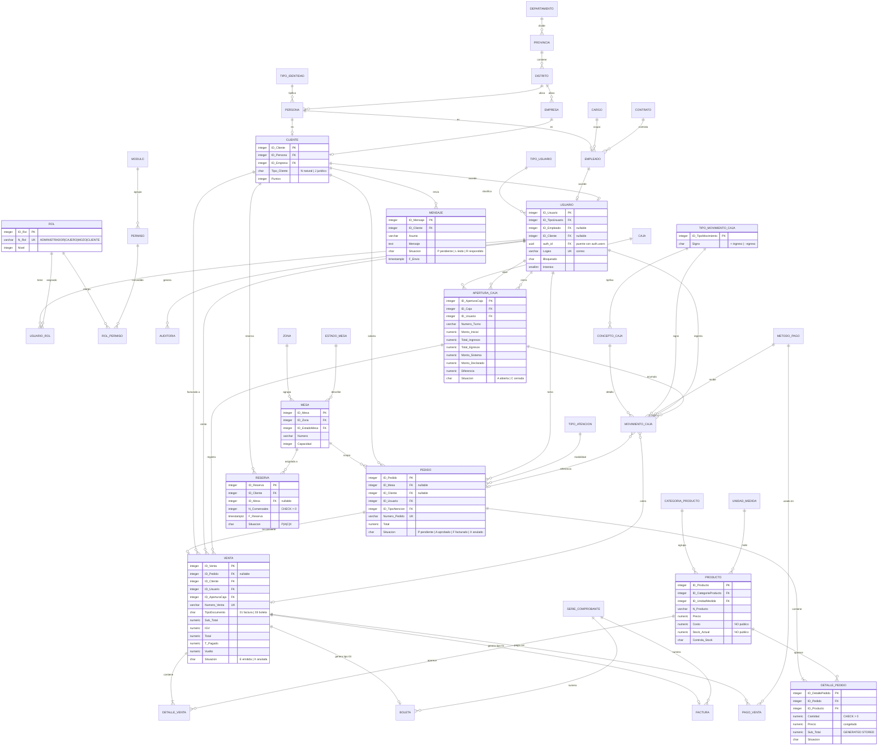

# Rodilla — Datos técnicos para el informe académico

> Capítulo II (Marco Teórico) y Capítulo III (Desarrollo del Sistema).
> Documento generado por inspección estática del repositorio y consultas
> de solo lectura contra la API REST de Supabase.
>
> ⚠️ **Criterio de este documento:** donde el enunciado suponía un dato
> (p. ej. «200+ registros por tabla») y la medición real difiere, se reporta
> la realidad medida y se marca con ⚠️. No se ha inventado ni estimado ningún
> valor.

## Índice

1. [Inventario del frontend](#1-inventario-del-frontend)
2. [Inventario de la base de datos](#2-inventario-de-la-base-de-datos)
3. [Diccionario de datos](#3-diccionario-de-datos)
4. [Funciones, triggers y procedimientos SQL](#4-funciones-triggers-y-procedimientos-sql)
5. [Los 6 CRUD implementados](#5-los-6-crud-implementados)
6. [Los 7 flujos del negocio](#6-los-7-flujos-del-negocio)
7. [Seguridad](#7-seguridad)
8. [Despliegue](#8-despliegue)
9. [Registros por tabla](#9-registros-por-tabla)
10. [Diagrama ERD (Mermaid)](#10-diagrama-erd-mermaid)
11. [Estructura de carpetas](#11-estructura-de-carpetas)
12. [Tecnologías usadas](#12-tecnologías-usadas)
13. [Hallazgos y discrepancias detectadas](#13-hallazgos-y-discrepancias-detectadas)

---

## 1. Inventario del frontend

### 1.1 Totales por tipo de archivo

| Tipo | Archivos | Líneas |
|---|---:|---:|
| HTML (`*.html`) | 20 | 1 371 |
| CSS (`*.css`) | 13 | 4 168 |
| JavaScript (`*.js`, módulos ES) | 53 | 5 193 |
| **Subtotal frontend** | **86** | **10 732** |
| SQL (referencia, fuera del deploy) | 22 | 3 344 |
| **Total del repositorio** | **108** | **14 076** |

**Desglose HTML (20 archivos).** Tres son *puntos de entrada* raíz, que Vercel
sirve como documentos; los otros diecisiete son *vistas de fragmento* que el
router inyecta con `fetch` dentro de `#app`.

| Grupo | Archivo | Líneas |
|---|---|---:|
| Raíz | `index.html` | 44 |
| Raíz | `auth.html` | 29 |
| Raíz | `dashboard.html` | 35 |
| `views/landing/` | `home.html` | 66 |
| `views/landing/` | `menu.html` | 41 |
| `views/landing/` | `reservas.html` | 47 |
| `views/landing/` | `contacto.html` | 35 |
| `views/landing/` | `nosotros.html` | 44 |
| `views/auth/` | `login.html` | 48 |
| `views/auth/` | `register.html` | 56 |
| `views/dashboard/` | `panel.html` | 87 |
| `views/dashboard/` | `carta.html` | 110 |
| `views/dashboard/` | `categorias.html` | 97 |
| `views/dashboard/` | `pedidos.html` | 129 |
| `views/dashboard/` | `reservas.html` | 119 |
| `views/dashboard/` | `mensajes.html` | 109 |
| `views/dashboard/` | `usuarios.html` | 95 |
| `views/dashboard/` | `mis-pedidos.html` | 58 |
| `views/dashboard/` | `mis-reservas.html` | 64 |
| `views/dashboard/` | `mis-mensajes.html` | 58 |

**Desglose CSS (13 archivos).**

| Subcarpeta | Archivo | Líneas | Contenido |
|---|---|---:|---|
| `css/` | `style.css` | 180 | **Tokens de diseño y definición de temas** |
| `css/base/` | `reset.css` | 86 | Reinicio de estilos por defecto del navegador |
| `css/base/` | `typography.css` | 19 | Escala tipográfica |
| `css/components/` | `components.css` | 726 | Botones, formularios, chips, cards, KPI, tablas |
| `css/components/` | `modal.css` | 688 | Modales, overlay, loading, notificaciones, carrito |
| `css/components/` | `hero.css` | 347 | Hero de portada |
| `css/components/` | `navigation.css` | 284 | Navbar y menú fullscreen |
| `css/components/` | `skeleton.css` | 171 | Estados de carga / skeleton |
| `css/components/` | `sidebar.css` | 131 | Sidebar del panel |
| `css/components/` | `topbar.css` | 87 | Topbar del panel |
| `css/pages/` | `dashboard.css` | 612 | Estilos del panel |
| `css/pages/` | `auth.css` | 446 | Pantalla de login y registro |
| `css/pages/` | `landing.css` | 391 | Estilos de la landing |

**Desglose JavaScript por capa (53 archivos).**

| Capa | Archivos | Líneas |
|---|---:|---:|
| `js/adapters/` | 7 | 809 |
| `js/components/` | 9 | 1 020 |
| `js/controllers/` | 4 | 578 |
| `js/lib/` | 2 | 89 |
| `js/services/` | 7 | 230 |
| `js/session/` | 3 | 76 |
| `js/utils/` | 2 | 60 |
| `js/views/auth/` | 2 | 159 |
| `js/views/dashboard/` | 12 | 1 765 |
| `js/views/landing/` | 5 | 407 |
| **Total** | **53** | **5 193** |

### 1.2 Frameworks y librerías externas

| Recurso | Versión | Tipo | Cómo se carga |
|---|---|---|---|
| **Supabase JS** (`@supabase/supabase-js`) | `2` | SDK cliente: GoTrue (Auth) + PostgREST + RPC | `import` desde CDN ESM: `https://esm.sh/@supabase/supabase-js@2` en `js/lib/supabaseClient.js:1` |
| **Reicon** | `1.2.4` | Web component de iconos (2 630 iconos, pesos Outline y Filled) | `<script defer src="https://unpkg.com/reicon@1.2.4/cdn/reicon.js">` en los 3 HTML raíz |
| **Google Fonts — Miranda Sans** | variable, ejes 400–700 + itálica | Tipografía | `<link href="https://fonts.googleapis.com/css2?family=Miranda+Sans:ital,wght@0,400..700;1,400..700&display=swap">` en los 3 HTML raíz |
| **Módulos ES nativos** | — | Sistema de módulos del navegador | `import` / `export` nativos, sin compilación |
| **Vercel** | — | Hosting / CDN | Despliegue del repositorio |

**No hay bundler, ni `package.json`, ni `node_modules`, ni framework de UI.** Todo
el JavaScript son módulos ES nativos servidos tal cual. El proyecto es *vanilla*
en sentido estricto.

Configuración del cliente Supabase (`js/lib/supabaseClient.js`):

```js
import { createClient } from "https://esm.sh/@supabase/supabase-js@2"

const SUPABASE_URL = "https://zmksxwgikagorgyeyhli.supabase.co"
const SUPABASE_ANON_KEY = "sb_publishable_…"
export const supabase = createClient(SUPABASE_URL, SUPABASE_ANON_KEY)
```

La clave es la nueva **publishable key** (`sb_publishable_…`), que sustituye a la
antigua clave `anon` JWT. Va incrustada en el bundle público **por diseño**: la
seguridad del sistema no depende de ocultarla, sino de Row Level Security (§7).

### 1.3 Estructura de carpetas de `js/`

```
js/
├── adapters/      ÚNICA capa que habla con Supabase (PostgREST / auth / rpc)
├── components/    Componentes de UI reutilizables (clases con .render())
├── controllers/   Puntos de entrada: uno por HTML raíz
├── lib/           Router e instancia del cliente Supabase
├── services/      Lógica de negocio; orquesta los adapters
├── session/       Guardas de sesión y de rol
├── utils/         Formato y notificaciones (fachada de Notification/Modal)
└── views/         Un controlador por ruta del router
    ├── auth/      login.js, register.js
    ├── dashboard/ panel, carta, categorias, pedidos, reservas, mensajes,
    │              usuarios, mis-pedidos, mis-reservas, mis-mensajes
    │              + crud-comun.js y mis-comun.js (bases compartidas)
    └── landing/   home.js, menu.js, reservas.js, contacto.js, nosotros.js
```

### 1.4 Capas del frontend

Arquitectura por capas con **dependencias dirigidas en un solo sentido**: ninguna
capa inferior importa a una superior.

```
HTML raíz → controllers/ → views/ → services/ → adapters/ → Supabase
                                ↘ components/, session/, utils/
                                  lib/ (Router, supabaseClient)
```

| Capa | Ubicación | Responsabilidad | Regla que respeta |
|---|---|---|---|
| **Controllers** (entry points) | `js/controllers/` | Montan el layout de la página, instancian los componentes, declaran el mapa de rutas y arrancan el `Router`. | Único tipo de archivo que se ejecuta solo, al ser importado por el HTML. |
| **Views** | `js/views/` | Un controlador por ruta. Consultan el DOM del HTML inyectado, pintan tablas y modales, y devuelven una **función de limpieza**. | No conocen Supabase. |
| **Services** | `js/services/` | Lógica de negocio. Traducen intención («crear producto») en llamadas al adapter y normalizan la respuesta a `{ ok, data }` / `{ ok, error }`. | No conocen el DOM. |
| **Adapters** | `js/adapters/` | **Única capa que ejecuta `supabase.from(...)`, `supabase.auth...` y `supabase.rpc(...)`.** Construye los payloads y resuelve sesión → `ID_Usuario` / `ID_Cliente`. | No contienen reglas de negocio. |
| **Components** | `js/components/` | Clases con constructor de opciones y `.render()` que devuelve un nodo DOM. | Sin acceso a datos. |
| **Session** | `js/session/` | Guardas: `guardSesion()`, `guardRol(roles)`, `opcionalSesion()`. | Redirección y verificación de rol. |
| **Utils** | `js/utils/` | `format.js` (fechas, moneda, escape de HTML) y `notify.js` (fachada de `Notification` y `Modal`). | Funciones sin estado. |
| **Lib** | `js/lib/` | `router.js` (Router hash-based) y `supabaseClient.js` (instancia única del SDK). | Infraestructura transversal. |

Detalle por capa:

- **`adapters/` — 7 archivos.** Son la frontera de confianza hacia la base de
  datos. `AuthAdapter` envuelve la API de autenticación; `UserAdapter` resuelve
  los roles vía `supabase.rpc("is_rol", …)`; los otros cinco (`Product`,
  `Category`, `Order`, `Reservation`, `Message`) hacen CRUD sobre PostgREST. Los
  adapters de pedido, reserva y mensaje implementan un helper privado
  `resolverSesion()` / `resolverCliente()` que **traduce el UUID de Supabase Auth
  al `ID_Usuario` / `ID_Cliente` interno** consultando `USUARIO` por `auth_id`.
- **`services/` — 7 archivos.** Todos exportan un objeto plano; todas sus
  funciones son `async`. Ninguno contiene una consulta a la base de datos; su
  trabajo es validar lo mínimo, delegar y normalizar el resultado.
- **`views/` — 17 controladores.** Convención estricta: cada vista exporta
  `export async function xController(contenedor)` y **devuelve la función de
  teardown** que el router ejecuta al navegar a otra vista. Esto evita que los
  `addEventListener` se acumulen en cada navegación.
- **`components/` — 9 clases.** Todas siguen el patrón
  `new Componente({...opciones}).render() → HTMLElement`.
- **`session/` — 3 guardas.** `guard.js` **se auto-invoca al importarse** (su
  última línea es una llamada suelta a `guardSesion()`): comportamiento
  deliberado y documentado, que evita tener que acordarse de invocarlo.
- **`utils/` — 2 módulos.** `escaparHTML()` es de uso obligatorio en cualquier
  interpolación de datos provenientes de la base dentro de plantillas
  (`innerHTML`).
- **`lib/` — 2 archivos.** `router.js` no tiene dependencias y expone
  `Router.irA(ruta)` como método estático para navegación imperativa.

### 1.5 Componentes reutilizables y su API

Todas las clases siguen el patrón `new Componente({ ...opciones }).render()`.
`Icon` y `Notification` exponen además funciones de módulo.

#### `Navbar` — `js/components/Navbar.js` (243 líneas)

```js
new Navbar({
  session,            // objeto user de Supabase, o null
  root,               // prefijo de ruta. Si se pasa → modo "páginas";
                      // si se omite → modo "hash"
  onSalir,            // () => void
  onToggleTema,       // () => void
  mostrarCarrito,     // boolean
  modoHash            // boolean (forzado)
}).render()
```

Funciona en **dos modos**, decididos automáticamente: `modoHash = !root`.

- **Modo *hash*** (landing `index.html`): enlaces `#/menu`, `#/reservas`, …; el
  burger despliega los links en línea.
- **Modo *páginas*** (HTML antiguos, montados desde `layout.js`): enlaces a
  `root + pagina`, y añade además el menú *fullscreen*
  (`#menu.menu-fullscreen`) que `menu.js` y `carrito.js` localizan por id.

Añade los botones `boton-carrito` (`#abrir-carrito`, con contador
`#cantidad-carrito`) y `nav-tema` (sol/luna). El icono del botón de tema es el
del tema **destino**, no el actual.

#### `Footer` — `js/components/Footer.js` (149 líneas)

```js
new Footer().render()
```

Sin opciones. Pie de página común con datos de contacto, horarios y redes.

#### `Modal` — `js/components/Modal.js` (117 líneas)

```js
new Modal({
  title = "",       // string
  body = "",        // string HTML o un Node
  actions = [],     // [{ label, className, onClick(modal, boton) }]
  id = null,
  className = "",
  onClose = null
})
modal.open(); modal.close()
modal.setTitle(titulo); modal.setBody(contenido)
```

- Estructura: `.modal-overlay.glass` › `.modal-content.glass.glass-strong` ›
  `.modal-header` / `.modal-body` / `.modal-footer`.
- Cierra con el botón ✕, con clic sobre el overlay y con la tecla `Escape`.
- Al abrir añade `body.sin-scroll`; al cerrar lo retira tras 300 ms.
- Accesibilidad: `role="dialog"` y `aria-modal="true"`.
- `open()` y `close()` son **idempotentes** (`isConnected` /
  `classList.contains("active")`).
- `body` acepta un `Node`: `_rellenar()` distingue `Node` de string.

#### `Notification` — `js/components/Notification.js` (201 líneas)

```js
new Notification({
  mensaje = "",
  titulo = "",
  tipo = "info",       // "success" | "error" | "warning" | "info"
  duracion = 4000,     // ms; 0 = permanente
  accion = null,       // { label, onClick(notificacion) }
  permanente = false,
  alCerrar = null
}).show()

notificar(mensaje, tipo, duracion)  // firma histórica, la que usan las vistas
cerrarNotificaciones()              // vacía la pila
contenedor()                        // devuelve o crea #notifications
```

- **Avisos apilados** con barra de progreso; máximo **4 simultáneos**
  (`MAX_VISIBLES`). Al superar el tope se cierra el más antiguo (`acotar()`).
- `.notifications` es `pointer-events: none`: la página **sigue viva debajo**,
  los clics y el scroll atraviesan la zona de avisos. Solo cada aviso captura
  eventos. Sin esto, un toast de 4 s sobre «Iniciar sesión» lo robaría durante
  4 segundos.
- **Pausa la cuenta atrás con `mouseenter`**, reanuda con `mouseleave`: si hay
  una acción que pulsar, el aviso no puede desaparecerle de la mano.
- Accesibilidad: `role="alert"` + `aria-live="assertive"` para error y warning;
  `role="status"` + `aria-live="polite"` para success e info.
- La activación visual es la clase `.visible`; un *reflow* forzado
  (`void element.offsetWidth`) asienta el estado inicial antes de añadirla, y
  así la animación no arranca a mitad. Se evita `requestAnimationFrame` a
  propósito porque se pausa en pestañas ocultas.

#### `Card` — `js/components/Card.js` (41 líneas)

```js
new Card({
  producto = {},   // { id, nombre, precio, img, detalle }
  categoria = "",  // clase CSS de sección: "bebidas" | "postres" | "aperitivos"
  onAgregar        // (producto, boton) => void
}).render()
```

Tarjeta de producto del menú: imagen con `loading="lazy"`, nombre, precio
formateado `S/ xx.xx` y botón «Agregar al carrito». Si no se pasa `onAgregar`,
serializa el producto en `data-producto` con
`encodeURIComponent(JSON.stringify(producto))`.

#### `Loading` — `js/components/Loading.js` (50 líneas)

```js
new Loading({ mensaje = "Cargando..." })
loading.show(mensaje?); loading.hide(); loading.remove()
```

Overlay `.glass.loading#loading` con un icono `loader-circle` de Reicon que usa
el **atributo `spin`** del web component, en lugar de unos `@keyframes` propios.

#### `Icon` — `js/components/Icon.js` (143 líneas) — *funciones, no clase*

```js
icon(nombre,  { size, className, titulo, spin })  // → HTMLElement <re-icon>
icono(nombre, { size, className, titulo, spin })  // → string, para innerHTML
MAPA_REICON   // { alias-del-proyecto: nombre-real-de-reicon }
NOMBRES       // string[] con los alias del proyecto
```

- Envuelve Reicon y expone **40 alias** del proyecto contra los nombres reales
  de Reicon (p. ej. `"circle-check" → "check-circle"`,
  `"circle-alert" → "alert-circle"`, `"utensils" → "fork-knife"`,
  `"layout-dashboard" → "layout"`).
- Fuerza siempre `weight="filled"`.
- Sin `titulo`, el icono se marca `decorative` y queda fuera de la
  accesibilidad; con `titulo`, se le asigna `label`.
- `nombreValido()` **no descarta nada** si el catálogo de Reicon aún no ha
  cargado (el script va con `defer`), y deja que el propio Reicon avise después.

Dos advertencias documentadas en el propio código, relevantes para el informe:

1. **Shadow DOM.** Reicon mete el `<svg>` dentro de su *shadow root*, así que
   el CSS del documento **no puede alcanzar el SVG interno**: hay que apuntar al
   host `re-icon`. El color y el tamaño sí se heredan (el host usa
   `currentColor` y el atributo `size`).
2. **`outerHTML` no sirve.** Un `<re-icon>` recién creado está **vacío**, porque
   el `<svg>` vive en el shadow root. Por eso existe la variante `icono()`, que
   devuelve el marcado directamente para usar en plantillas.

#### `Sidebar` — `js/components/Sidebar.js` (120 líneas)

```js
new Sidebar({ seccion = null, rol = "CLIENTE", onLogout = null }).render()
sidebar.setSeccion(seccion)   // repinta el activo sin rehacer el menú
```

El menú depende del rol: `MENU_ADMIN` (7 ítems), `MENU_OPERATIVO` (4) y
`MENU_CLIENTE` (4). El enlace activo recibe `sidebar__link--active` **y**
`aria-current="page"`. `setSeccion()` actualiza los `aria-current` sin volver a
renderizar el menú completo.

#### `Topbar` — `js/components/Topbar.js` (108 líneas)

```js
new Topbar({ user, titulo, onLogout, onToggleSidebar, onToggleTheme }).render()
topbar.setTitulo(titulo)   // cambia solo el texto, sin rehacer la cabecera
```

Cabecera del panel: botón burger (solo móvil; el CSS lo oculta en escritorio),
título `<h1>`, nombre del usuario con degradaciones
(`nombre` → `Nombre` → `email` → `EMAIL` → «Invitado»), botón de tema y botón de
logout. El icono del botón de tema **sí se anida** al botón, y es el del tema
destino.

### 1.6 Router

**Archivo:** `js/lib/router.js` — clase `Router`, 105 líneas, **sin
dependencias**.

**Tipo:** *hash-based* (`#/ruta`). No usa History API, no necesita reglas de
reescritura en el servidor, y por eso funciona también abierto como HTML suelto
(dentro de lo que el navegador permita).

```js
const BASE_VISTAS = "views/"

new Router({
  rutas,          // { "/ruta": { vista, controlador } }
  contenedor,     // selector CSS, p. ej. "#app"
  porDefecto = "/"
})
router.start(); router.stop(); router.navigate(ruta)
router.obtenerRutaActual()
Router.irA(ruta)          // estático: asigna window.location.hash
```

**Ciclo de `navigate(ruta)`:**

1. Lee `window.location.hash` (sin el `#`) o cae en `porDefecto`.
2. Busca la entrada en `this.rutas`. Si no existe: emite `console.warn`, carga
   la de defecto, y guarda en `this.actual` **la ruta realmente cargada**, no la
   pedida.
3. Ejecuta la **función de limpieza** que dejó la vista anterior
   (`this.limpieza`), envuelta en `try/catch`.
4. `fetch(`${BASE_VISTAS}${entrada.vista}.html`)`. Si la respuesta no es `ok`,
   lanza `Error("HTTP <status> al pedir <vista>")`.
5. Inyecta el HTML con `nodo.innerHTML = await respuesta.text()`.
6. Invoca `await entrada.controlador(nodo)`. Si el controlador **devuelve una
   función**, se guarda como teardown para la próxima navegación.
7. `nodo.scrollIntoView({ block: "start" })`.
8. Ante cualquier error, pinta `<p class="router-error">No se pudo cargar la
   vista. Revisa la consola.</p>` en el contenedor.

`start()` registra el listener de `hashchange` y navega a la ruta actual.
`stop()` lo quita y ejecuta el teardown.

**Decisiones de diseño documentadas en el código:**

- El teardown existe porque `innerHTML = ""` **no** invoca ningún destructor.
  Sin él, los `addEventListener` de cada vista se acumularían en cada
  navegación. De ahí el contrato: las vistas devuelven su función de limpieza.
- En la versión básica del enunciado, `this.actual = ruta` guardaba la ruta
  *pedida* aunque se hubiera cargado otra. Aquí se corrige: `this.actual` guarda
  la ruta **realmente cargada**.
- `fetch` exige `http(s)`: abierto con `file://` el navegador bloquea las
  peticiones a archivos locales y **todas** las vistas fallan. Por eso el
  router avisa en consola en el caso de ruta desconocida.

**Mapa de rutas (3 tablas, 17 rutas).**

| HTML raíz | Controlador | Rutas |
|---|---|---|
| `index.html` | `js/controllers/landing.js` | `/`, `/menu`, `/reservas`, `/contacto`, `/nosotros` (5) |
| `auth.html` | `js/controllers/auth.js` | `/login`, `/register` (2) |
| `dashboard.html` | `js/controllers/dashboard.js` | `/dashboard`, `/dashboard/carta`, `/dashboard/categorias`, `/dashboard/pedidos`, `/dashboard/reservas`, `/dashboard/mensajes`, `/dashboard/usuarios`, `/dashboard/mis-pedidos`, `/dashboard/mis-reservas`, `/dashboard/mis-mensajes` (10) |

Los tres controladores publican la instancia en `window.__router` para
depuración.

**Efectos colaterales de los controladores, documentados en el código:**

- `js/controllers/auth.js` **no** importa `session/guard.js` a propósito: ese
  módulo se auto-invoca al importarse y, como `auth.html` está en su lista de
  páginas públicas, expulsaría al visitante de la propia pantalla que está
  pintando.
- `js/controllers/dashboard.js` llama a `guardSesion()` explícitamente **en
  lugar de** importar `guard.js` y no usar el retorno, para no disparar una
  segunda petición a Supabase.
- `js/controllers/landing.js` importa `menu.js`, que arrastra `carrito.js`, que
  **se auto-inicializa al importarse**. Por eso el navbar se monta con
  `mostrarCarrito: true`.
- El navbar y la vista se inicializan **en paralelo**: la cabecera se pinta de
  inmediato con `session = null` y se repinta cuando llega la sesión, para que
  con red lenta la cabecera no quede en blanco.

### 1.7 Sistema de temas

**Mecanismo:** atributo `data-theme` en el elemento raíz `<html>`, con dos
valores: `"dark"` (por defecto, escrito en el propio HTML) y `"light"`.

**Tokens:** todos declarados en **`css/style.css`**, único archivo del proyecto
donde se permite un literal hexadecimal. El resto del CSS solo consume
`var(--…)`. La regla es explícita en la cabecera del archivo: *«ÚNICO archivo
donde se declaran colores… Si aparece un hex literal fuera de aquí, es un
bug.»*

#### Tokens invariantes (`:root`, no cambian con el tema)

| Grupo | Tokens | Valores |
|---|---|---|
| Marca | `--brand-brown` `--brand-green` `--brand-rose` `--brand-cream` `--brand-cream-soft` `--white` `--black` | `#360e06` `#1e3932` `#6d1834` `#ffe8c9` `#fff4e6` `#ffffff` `#000000` |
| Categorías de producto | `--cat-bebidas` `--cat-postres` `--cat-aperitivos` | `#a82b13` `#720c61` `#234564` |
| Estados crudos | `--state-success` `--state-danger` `--state-warning` `--state-info` | `#2ecc71` `#e74c3c` `#f1c40f` `#3498db` |
| Espaciado | `--space-xs/sm/md/lg/xl` | 4 / 8 / 16 / 24 / 40 px |
| Radios | `--radius-sm/md/lg/full` | 10 / 20 / 30 / 50 px |
| Shell | `--shell-ancho` `--shell-padding-x` | 80% / 30px |
| Sombras | `--shadow-sm` `--shadow-md` | — |
| Tipografía | `--font-family` | `"Miranda Sans", sans-serif` |
| z-index | `--z-nav` `--z-modal` `--z-drawer` `--z-fullscreen` `--z-panel` `--z-loader` `--z-toast` | 100 / 1000 / 1100 / 2000 / 2400 / 2500 / 3000 |
| Movimiento | `--transition` `--transition-slow` | 0.3s / 0.4s ease |

La escala de z-index existe porque antes `.modal-overlay`, `.block-menu`,
`.carrito-panel`, `.notification` y `.form-add-producto` compartían los valores
1000 / 9999 y **empataban**: el orden del DOM decidía cuál tapaba a cuál. Ahora
cada capa tiene su valor y las dependencias están documentadas.

#### Tokens semánticos por tema

| Token | `:root, [data-theme="dark"]` | `[data-theme="light"]` |
|---|---|---|
| `color-scheme` | `dark` | `light` |
| `--bg` | `var(--brand-brown)` `#360e06` | `var(--brand-cream-soft)` `#fff4e6` |
| `--bg-alt` | `var(--brand-green)` `#1e3932` | `#ffffff` |
| `--surface` | `rgba(255,255,255,.06)` | `rgba(255,255,255,.72)` |
| `--surface-strong` | `rgba(255,255,255,.10)` | `rgba(255,255,255,.85)` |
| `--surface-hover` | `rgba(255,255,255,.14)` | `#ffffff` |
| `--surface-solid` | `#1f1a17` | `#ffffff` |
| `--glass-surface` | `rgba(255,255,255,.10)` | `rgba(255,255,255,.20)` |
| `--glass-strong` | `rgba(255,255,255,.18)` | `rgba(255,255,255,.35)` |
| `--border` | `rgba(255,255,255,.15)` | `rgba(30,57,50,.18)` |
| `--border-strong` | `rgba(255,255,255,.42)` | `rgba(30,57,50,.45)` |
| `--text` | `#ffffff` | `var(--brand-green)` `#1e3932` |
| `--text-muted` | `rgba(255,255,255,.60)` | `rgba(30,57,50,.65)` |
| `--text-subtle` | `rgba(255,255,255,.85)` | `rgba(30,57,50,.85)` |
| `--accent` | `var(--brand-cream)` `#ffe8c9` | `var(--brand-green)` |
| `--accent-hover` | `#ffffff` | `var(--brand-rose)` `#6d1834` |
| `--accent-text` | `var(--brand-brown)` | `var(--brand-cream-soft)` |
| `--link` | `var(--brand-cream)` | `var(--brand-rose)` |
| `--focus` | `var(--brand-cream)` | `var(--brand-rose)` |
| `--overlay` | `rgba(54,14,6,.55)` | `rgba(109,24,52,.38)` |
| `--menu-tint` | `rgba(54,14,6,.31)` | `rgba(255,232,201,.37)` |
| `--text-shadow` | `rgba(73,41,3,.575)` | `rgba(255,224,186,.55)` |
| `--danger` | `#ff9d8a` | `#d81b44` |
| `--success` | `var(--state-success)` `#2ecc71` | `#1e7a45` |
| `--warning` | `var(--state-warning)` `#f1c40f` | `#8a6100` |
| `--info` | `var(--state-info)` `#3498db` | `#1f5b8f` |
| `--table-head` | `rgba(255,255,255,.18)` | `rgba(30,57,50,.10)` |
| `--table-row-hover` | `rgba(255,255,255,.10)` | `rgba(30,57,50,.06)` |
| `--table-danger-row` | `rgba(216,27,68,.171)` | `rgba(216,27,68,.12)` |
| `--shadow-color` | `rgba(0,0,0,.15)` | `rgba(30,57,50,.12)` |

**Nota de accesibilidad documentada en el CSS.** Sobre crema,
`--state-danger` (`#e74c3c`) da solo **3.5:1** y no cumple WCAG AA. Por eso el
tema claro sustituye los cuatro estados por variantes propias que sí cumplen:
4.6:1 en claro y 8:1 en oscuro.

También hay una asimetría deliberada entre `--surface-strong` (control: 0.85 en
claro, para que un input se lea) y `--glass-surface` (vidrio: 0.20 en claro, para
que siga siendo translúcido). El vidrio nunca se vuelve opaco.

#### Cambio de tema y persistencia

1. **Clave de almacenamiento:** `"rodilla:theme"` en `localStorage` — **la misma
   clave en landing y panel**, porque la preferencia es de la persona, no de la
   página.
2. **Anti-parpadeo:** un `<script>` inline en el `<head>` de `index.html`, antes
   de cualquier hoja de estilos, lee `localStorage` y asigna
   `document.documentElement.dataset.theme`. Va en el head y sin módulo porque
   cualquier otro punto es tarde. Está envuelto en `try/catch` para el modo
   privado del navegador, que lanza al acceder a `localStorage`.
3. **Toggle:** `alternarTema()` en `landing.js:44` y `dashboard.js:99`
   intercambia `dataset.theme` entre `"dark"` y `"light"`, guarda en
   `localStorage` y **repinta la cabecera completa**.
4. **Por qué repintar y no tocar el botón:** el icono del botón es el del tema
   **destino**, no el actual (sol cuando estamos en oscuro, luna al revés). Si
   solo se cambiara el atributo, se seguiría viendo el icono viejo. En el panel
   hay que re-renderizar además con `tituloActual` explícito, o el título volvería
   a «Panel» en cada pulsación del toggle.
5. **Lectura al arrancar:** `aplicarTemaGuardado()` en `dashboard.js:59` valida
   que el valor guardado sea exactamente `"dark"` o `"light"` antes de aplicarlo.

---

## 2. Inventario de la base de datos

**Motor:** PostgreSQL (gestionado por Supabase).
**Esquema:** `public`.
**Extensiones:** `pgcrypto` y `uuid-ossp` (`sql/001_extensions.sql`).

### 2.1 Totales

| Métrica | Valor |
|---|---:|
| **Tablas** | **41** |
| Vistas | 1 (`PRODUCTO_PUBLICO`) |
| Tablas con RLS habilitado | **41** (el 100%) |
| Policies RLS vigentes | **67** (ver §4.5) |
| Funciones de autorización (`is_*`) | 4 |
| Funciones de trigger | 3 |
| Procedimientos `public.usp_*` | 9 |
| Triggers | 3 (+ 1 índice único parcial) |
| Índices creados explícitamente | 54 |

**Convención universal de auditoría.** Las 41 tablas comparten, sin excepción,
7 columnas de control:

| Columna | Tipo | Default | Significado |
|---|---|---|---|
| `USUCRE` | `varchar(30)` | (en `AUDITORIA`: `current_user`) | Usuario que creó la fila |
| `PCCRE` | `varchar(30)` | `null` | PC que creó la fila |
| `FECCRE` | `timestamptz` | `now()` | Fecha de creación |
| `USUMOD` | `varchar(30)` | `null` | Usuario que modificó |
| `PCMOD` | `varchar(30)` | `null` | PC que modificó |
| `FECMOD` | `timestamptz` | `null` | Fecha de modificación |
| `ESTADO` | `char(1)` | `'1'` | Baja lógica: `'1'` activo, `'0'` inactivo |

`USUCRE` y `ESTADO` son `NOT NULL` en las 41 tablas. Por eso los adapters y las
vistas los rellenan **siempre**, y con
`String(valor || "WEB").substring(0, 30)`, porque la columna es `varchar(30)` y
un correo más largo truncaría el `INSERT`.

Convención adicional: todas las PK son
`integer generated always as identity primary key`, y **todos los nombres de
columna y tabla van entrecomillados en mayúsculas** (`"ID_Pedido"`), lo que
obliga a usar comillas dobles en cualquier `SELECT` y obliga a conservar el nombre
exacto.

### 2.2 Geografía (3 tablas)

#### DEPARTAMENTO
- **PK:** `ID_Departamento` (identity)
- **FK:** —
- **Restricciones:** `N_Departamento` `varchar(30) NOT NULL`; `USUCRE` `NOT NULL`; `ESTADO` `NOT NULL DEFAULT '1'`
- **Descripción:** Nivel 1 de la división política. Catálogo de referencia.

#### PROVINCIA
- **PK:** `ID_Provincia` (identity)
- **FK:** `ID_Departamento` → `DEPARTAMENTO`, constraint `FK_PROVINCIA_DEPARTAMENTO`
- **Restricciones:** `ID_Departamento` `integer NOT NULL`; `N_Provincia` `varchar(30) NOT NULL`
- **Descripción:** Nivel 2. Pertenece a un departamento.

#### DISTRITO
- **PK:** `ID_Distrito` (identity)
- **FK:** `ID_Provincia` → `PROVINCIA`, constraint `FK_DISTRITO_PROVINCIA`
- **Restricciones:** `ID_Provincia` `integer NOT NULL`; `D_Distrito` `varchar(40) NOT NULL`
- **Descripción:** Nivel 3, la unidad territorial más fina. Es la que se
  almacena en `PERSONA.ID_Distrito` y `EMPRESA.ID_Distrito`.

### 2.3 Personas (4 tablas)

#### TIPO_IDENTIDAD
- **PK:** `ID_TipoIdentidad` (identity) · **FK:** —
- **Restricciones:** `N_TipoIdentidad` `varchar(20) NOT NULL`; `Abreviatura` `varchar(10) NOT NULL`; `Longitud` `integer NOT NULL`; `Codigo_SUNAT` `char(1)` nullable
- **Descripción:** Catálogo de tipos de documento (DNI, RUC, CARNET
  EXTRANJERIA, PASAPORTE) con su longitud y su código SUNAT.
  `Abreviatura = 'DNI'` es el valor que busca el trigger de alta.

#### PERSONA
- **PK:** `ID_Persona` (identity)
- **FK:** `ID_Distrito` → `DISTRITO` (`FK_PERSONA_DISTRITO`); `ID_TipoIdentidad` → `TIPO_IDENTIDAD` (`FK_PERSONA_TIPOIDENTIDAD`)
- **Restricciones:** `ID_TipoIdentidad` `NOT NULL`; `N_Documento` `varchar(15) NOT NULL`; `Nombre` `varchar(80) NOT NULL`; `Ap_Paterno`/`Ap_Materno` `varchar(80)`; `F_Nacimiento` `date`; `EMAIL` `varchar(50)`; `Celular` `char(9)`; `Genero` `char(1)`; `Direccion` `varchar(100)`; **`UQ_PERSONA_DOCUMENTO` UNIQUE (`ID_TipoIdentidad`, `N_Documento`)**; **`CK_PERSONA_GENERO` CHECK (`Genero` IN ('M','F') OR `Genero` IS NULL)**
- **Descripción:** Datos de la persona natural. La unicidad del documento es
  **compuesta**, porque un mismo número puede repetirse entre tipos distintos.

#### EMPRESA
- **PK:** `ID_Empresa` (identity)
- **FK:** `ID_Distrito` → `DISTRITO` (`FK_EMPRESA_DISTRITO`)
- **Restricciones:** `RUC` `char(11) NOT NULL`; `Razon_Social` `varchar(140) NOT NULL`; `Nombre_Comercial` `varchar(140)`; `Direccion` `varchar(150)`; `Telefono` `varchar(15)`; **`UQ_EMPRESA_RUC` UNIQUE (`RUC`)**
- **Descripción:** Persona jurídica. `Razon_Social` y `Direccion` son los datos
  que `usp_FacturarPedido` copia a la tabla `FACTURA` al emitir.

#### CLIENTE
- **PK:** `ID_Cliente` (identity)
- **FK:** `ID_Persona` → `PERSONA` (`FK_CLIENTE_PERSONA`); `ID_Empresa` → `EMPRESA` (`FK_CLIENTE_EMPRESA`)
- **Restricciones:** `Tipo_Cliente` `char(1) NOT NULL`; `Puntos` `integer NOT NULL DEFAULT 0`; `F_Registro` `timestamptz NOT NULL DEFAULT now()`; `Observacion` `varchar(200)`; **`CK_CLIENTE_TIPO` CHECK** de *discriminación de tipos*:
  ```sql
  CHECK (
      ("Tipo_Cliente" = 'N' and "ID_Persona" is not null and "ID_Empresa" is null) or
      ("Tipo_Cliente" = 'J' and "ID_Empresa" is not null and "ID_Persona" is null)
  )
  ```
- **Descripción:** Cliente de la cafetería, natural o jurídico. Es el sujeto
  central de `PEDIDO`, `RESERVA` y `MENSAJE`. El CHECK garantiza la
  **exclusividad** de la parte: un natural no puede tener empresa y un jurídico no
  puede tener persona. La corrección **C3** de `018_fixes.sql` añadió la
  condición `ID_Persona is null` al caso jurídico, que faltaba en el script
  original.

### 2.4 RRHH (3 tablas)

#### CARGO
- **PK:** `ID_Cargo` · **FK:** — · `N_Cargo` `varchar(40) NOT NULL`
- **Descripción:** Puesto de trabajo (ADMINISTRADOR, CAJERO, BARISTA, MOZO,
  AYUDANTE DE COCINA).

#### CONTRATO
- **PK:** `ID_Contrato` · **FK:** — · `N_Contrato` `varchar(40) NOT NULL`; `Descripcion` `varchar(150)`
- **Descripción:** Modalidad contractual (plazo indeterminado, plazo fijo, part
  time).

#### EMPLEADO
- **PK:** `ID_Empleado` · **FK:** `ID_Persona` → `PERSONA`; `ID_Contrato` → `CONTRATO`; `ID_Cargo` → `CARGO` (las tres `NOT NULL`)
- **Restricciones:** `Salario` `numeric(8,2) NOT NULL`; `Turno` `varchar(18)`; `Fondo_Pension` `char(3)`; `N_Hips` `char(11)`; `ESSALUD` `char(6)`; `F_Ingreso` `date NOT NULL DEFAULT current_date`; `F_Cese` `date` nullable; **`UQ_EMPLEADO_PERSONA` UNIQUE (`ID_Persona`)**
- **Descripción:** Prestador de la empresa. `USUARIO.ID_Empleado` es nullable a
  propósito: un cliente registrado no es empleado.

### 2.5 Seguridad (8 tablas)

#### TIPO_USUARIO
- **PK:** `ID_TipoUsuario` · **FK:** — · `N_TipoUsuario` `varchar(50) NOT NULL`
- **Valores seed:** 1 ADMINISTRADOR, 2 OPERATIVO, 3 CLIENTE.
- **Descripción:** Clasificación gruesa del usuario. El trigger de alta usa
  `ID_TipoUsuario = 3`.

#### USUARIO
- **PK:** `ID_Usuario` (identity)
- **FK:** `ID_TipoUsuario` → `TIPO_USUARIO` (`NOT NULL`); `ID_Empleado` → `EMPLEADO` (nullable); `ID_Cliente` → `CLIENTE` (nullable)
- **Columna puente:** `auth_id uuid` — el UUID de `auth.users` que enlaza la
  identidad de Supabase Auth con la fila del dominio. Es la columna que compara
  `auth.uid()` en todas las policies.
- **Restricciones:** `Logeo` `varchar(120) NOT NULL`; `Intentos` `smallint NOT NULL DEFAULT 0`; `Bloqueado` `char(1) NOT NULL DEFAULT '0'`; `F_UltimoAcceso` `timestamptz`; **`UQ_USUARIO_LOGEO` UNIQUE (`Logeo`)**; **`UQ_USUARIO_AUTHID` UNIQUE (`auth_id`)**; **`CK_USUARIO_BLOQUEADO` CHECK (`Bloqueado` IN ('0','1'))**; **`CK_USUARIO_INTENTOS` CHECK (`Intentos` >= 0)**
- **Descripción:** Cuenta del sistema. **No almacena contraseña**: la verifica
  Supabase Auth. `Logeo` es el correo. La tabla se «desata» de `EMPLEADO`
  (enlace nullable) para que un cliente pueda tener usuario sin ser empleado.
  La columna `Logeo` se ensanchó de `varchar(30)` a `varchar(120)` en la
  corrección **C1**, para admitir correos completos.

#### MODULO
- **PK:** `ID_Modulo` · **FK:** — · `N_Modulo` `varchar(50) NOT NULL`; `Descripcion` `varchar(100)`; `Icono` `varchar(50)`; `Orden` `integer NOT NULL DEFAULT 0`
- **Descripción:** Agrupación funcional de permisos (SEGURIDAD, CLIENTES,
  PRODUCTOS, PEDIDOS, VENTAS, CAJA, REPORTES, AUDITORIA).

#### ROL
- **PK:** `ID_Rol` · **FK:** — · `N_Rol` `varchar(50) NOT NULL`; `Descripcion` `varchar(100)`; `Nivel` `integer NOT NULL DEFAULT 1`; `F_Creacion` `timestamptz NOT NULL DEFAULT now()`
- **Restricciones:** **`UQ_ROL_NOMBRE` UNIQUE (`N_Rol`)**
- **Descripción:** Perfil de seguridad. 4 roles seeded: ADMINISTRADOR (nivel 1),
  CAJERO (2), MOZO (3), CLIENTE (4). **El nombre del rol es la clave** que
  comparan `is_rol()` e `is_operativo()`.

#### PERMISO
- **PK:** `ID_Permiso` · **FK:** `ID_Modulo` → `MODULO` (`NOT NULL`, `FK_PERMISO_MODULO`) · `N_Permiso` `varchar(50) NOT NULL`; `Clave` `varchar(50) NOT NULL`
- **Restricciones:** **`UQ_PERMISO_CLAVE` UNIQUE (`Clave`)**
- **Descripción:** Acción atómica. 15 permisos seeded con clave: `SEG_USUARIO`,
  `SEG_ROL`, `CLI_GESTIONAR`, `PRO_GESTIONAR`, `PRO_PRECIO`, `PED_REGISTRAR`,
  `PED_ANULAR`, `VEN_REGISTRAR`, `VEN_ANULAR`, `VEN_DESCUENTO`, `CAJ_APERTURAR`,
  `CAJ_MOVIMIENTO`, `CAJ_CERRAR`, `REP_VER`, `AUD_VER`.

#### ROL_PERMISO
- **PK:** `ID_RolPermiso` · **FK:** `ID_Rol` → `ROL`; `ID_Permiso` → `PERMISO`
- **Restricciones:** `Concedido` `char(1) NOT NULL DEFAULT '1'`; **`UQ_ROL_PERMISO` UNIQUE (`ID_Rol`, `ID_Permiso`)**
- **Descripción:** Tabla puente rol↔permiso. Distribución seeded:
  ADMINISTRADOR recibe los **15** permisos; CAJERO **7**
  (`CLI_GESTIONAR`, `PED_REGISTRAR`, `VEN_REGISTRAR`, `CAJ_APERTURAR`,
  `CAJ_MOVIMIENTO`, `CAJ_CERRAR`, `REP_VER`); MOZO **1** (`PED_REGISTRAR`);
  CLIENTE **0**.

#### USUARIO_ROL
- **PK:** `ID_UsuarioRol` · **FK:** `ID_Usuario` → `USUARIO`; `ID_Rol` → `ROL`
- **Restricciones:** `F_Asignacion` `timestamptz NOT NULL DEFAULT now()`; `Vigente` `char(1) NOT NULL DEFAULT '1'`; **`UQ_USUARIO_ROL` UNIQUE (`ID_Usuario`, `ID_Rol`)** — constraint que `usp_PromoverAdmin` exploit con `ON CONFLICT`
- **Descripción:** Tabla puente usuario↔rol. `Vigente` permite revocar un rol
  sin borrar la fila. Un usuario puede tener varios roles; el panel toma **el
  primero de la lista** como rol principal.

#### AUDITORIA
- **PK:** `ID_Auditoria` · **FK:** `ID_Usuario` → `USUARIO` (nullable)
- **Restricciones:** `N_Tabla` `varchar(50) NOT NULL`; `Accion` `varchar(20) NOT NULL`; `Valor_Anterior` / `Valor_Nuevo` `varchar(500)`; `F_Evento` `timestamptz NOT NULL DEFAULT now()`; `IP` **`varchar(45)`**; `Terminal` `varchar(30)`
- **Descripción:** Bitácora de eventos con valor anterior y nuevo. La escribe
  `usp_CerrarCaja` (acción `CIERRE`) y el handler de excepciones del trigger de
  alta (acción `ERROR`). `IP` pasó de `varchar(20)` a `varchar(45)` en la
  corrección **C5**, para soportar IPv6.

### 2.6 Catálogo (3 tablas)

#### UNIDAD_MEDIDA
- **PK:** `ID_UnidadMedida` · **FK:** — · `N_UnidadMedida` `varchar(30) NOT NULL`; `Abreviatura` `varchar(10) NOT NULL`
- **Descripción:** 6 unidades seeded: UNIDAD (UND), TAZA (TZA), VASO (VAS),
  PORCION (POR), BOTELLA (BOT), KILOGRAMO (KG).

#### CATEGORIA_PRODUCTO
- **PK:** `ID_CategoriaProducto` · **FK:** — · `N_CategoriaProducto` `varchar(50) NOT NULL`; `Descripcion` `varchar(100)`; `Area_Preparacion` `varchar(20)`; `F_Creacion` `timestamptz NOT NULL DEFAULT now()`
- **Descripción:** 6 categorías del modelo original: CAFES CALIENTES, BEBIDAS
  FRIAS, POSTRES, SANDWICHES, DESAYUNOS, ADICIONALES.
  `Area_Preparacion` ∈ {BARRA, COCINA, VITRINA} y cumple dos funciones: colorea
  la fila en la carta y decide la sección del menú.

#### PRODUCTO
- **PK:** `ID_Producto` · **FK:** `ID_CategoriaProducto` → `CATEGORIA_PRODUCTO` (`NOT NULL`, `FK_PRODUCTO_CATEGORIA`); `ID_UnidadMedida` → `UNIDAD_MEDIDA` (`NOT NULL`, `FK_PRODUCTO_UNIDAD`)
- **Restricciones:** `N_Producto` `varchar(50) NOT NULL`; `Precio` `numeric(8,2) NOT NULL`; `Costo` `numeric(8,2) NOT NULL DEFAULT 0`; `Stock_Actual` / `Stock_Minimo` `numeric(10,2) NOT NULL DEFAULT 0`; `Controla_Stock` `char(1) NOT NULL DEFAULT '1'`; `Es_Preparado` `char(1) NOT NULL DEFAULT '0'`; `Afecto_IGV` `char(1) NOT NULL DEFAULT '1'`; `Marca` `varchar(50)`; `Codigo_Barras` `varchar(30)`; `Imagen` `varchar(200)`; **`CK_PRODUCTO_PRECIO` CHECK (`Precio` >= 0)**; **`CK_PRODUCTO_COSTO` CHECK (`Costo` >= 0 AND `Costo` <= `Precio`)**
- **Descripción:** Ítem de la carta. `Controla_Stock = '0'` marca los productos
  preparados, que no se inventarían aunque se descuenten al vender.

### 2.7 Salón (4 tablas)

#### ZONA
- **PK:** `ID_Zona` · **FK:** — · `N_Zona` `varchar(50) NOT NULL`; `Descripcion` `varchar(100)`
- **Descripción:** 3 zonas seeded: SALON PRINCIPAL, TERRAZA, BARRA.

#### ESTADO_MESA
- **PK:** `ID_EstadoMesa` · **FK:** — · `Descripcion` `varchar(50) NOT NULL`; `Color` `varchar(10)`; `F_Creacion` `timestamptz NOT NULL DEFAULT now()`
- **Descripción:** 4 estados seeded: 1 LIBRE (`#2ECC71`), 2 OCUPADA (`#E74C3C`),
  3 RESERVADA (`#F1C40F`), 4 POR COBRAR (`#3498DB`).
  Los procedimientos referencian el **id literal**: `2` = ocupada, `1` = libre.

#### MESA
- **PK:** `ID_Mesa` · **FK:** `ID_Zona` → `ZONA` (`NOT NULL`); `ID_EstadoMesa` → `ESTADO_MESA` (`NOT NULL`)
- **Restricciones:** `Numero` `varchar(5) NOT NULL`; `Capacidad` `integer NOT NULL DEFAULT 4`; `Detalle` `varchar(100)`; **`UQ_MESA_NUMERO` UNIQUE (`ID_Zona`, `Numero`)**
- **Descripción:** 8 mesas seeded: 01–04 en salón (capacidades 4, 4, 2, 6),
  05–06 en terraza, B1–B2 en barra. La unicidad del número es **compuesta**,
  porque el mismo número puede repetirse en zonas distintas.

#### TIPO_ATENCION
- **PK:** `ID_TipoAtencion` · **FK:** — · `N_TipoAtencion` `varchar(30) NOT NULL`; `Requiere_Mesa` `char(1) NOT NULL DEFAULT '1'`
- **Descripción:** 3 tipos seeded: EN SALON (`Requiere_Mesa='1'`), PARA LLEVAR
  (`'0'`), DELIVERY (`'0'`). `OrderAdapter` resuelve `"PARA LLEVAR"` **por
  nombre** para los pedidos web, y `listarTipos()` para los desplegables del
  panel.

### 2.8 Pago (2 tablas)

#### METODO_PAGO
- **PK:** `ID_MetodoPago` · **FK:** — · `N_MetodoPago` `varchar(30) NOT NULL`; `Es_Efectivo` `char(1) NOT NULL DEFAULT '0'`; `Requiere_Ref` `char(1) NOT NULL DEFAULT '0'`
- **Descripción:** 6 métodos seeded: EFECTIVO (`Es_Efectivo='1'`), TARJETA
  DEBITO, TARJETA CREDITO, YAPE, PLIN, TRANSFERENCIA. `Es_Efectivo` es lo que
  decide si el movimiento de caja afecta al efectivo del turno.

#### SERIE_COMPROBANTE
- **PK:** `ID_Serie` · **FK:** — · `TipoDocumento` `char(2) NOT NULL`; `Serie` `char(4) NOT NULL`; `Correlativo` `integer NOT NULL DEFAULT 0`; `Descripcion` `varchar(50)`
- **Restricciones:** **`UQ_SERIE` UNIQUE (`TipoDocumento`, `Serie`)**; **`CK_SERIE_TIPODOC` CHECK (`TipoDocumento` IN ('01','03','07','08'))** (factura, boleta, nota de crédito, guía de remisión)
- **Descripción:** Secuencia de numeración por tipo de documento. Seeded con
  `('03','B001',0)` y `('01','F001',0)`.

### 2.9 Caja (5 tablas)

#### CAJA
- **PK:** `ID_Caja` · **FK:** — · `N_Caja` `varchar(50) NOT NULL`; `Descripcion` `varchar(100)`; `Ubicacion` `varchar(100)`; `Serie_Terminal` `varchar(30)`; `Moneda` `char(3) NOT NULL DEFAULT 'PEN'`; `Monto_Base` `numeric(12,2) NOT NULL DEFAULT 0`; `Aperturada` `char(1) NOT NULL DEFAULT '0'`
- **Descripción:** Caja física. `Aperturada` es un flag desnormalizado que
  `usp_AperturarCaja` pone a `'1'` y `usp_CerrarCaja` a `'0'`.

#### APERTURA_CAJA
- **PK:** `ID_AperturaCaja` · **FK:** `ID_Caja` → `CAJA` (`NOT NULL`); `ID_Usuario` → `USUARIO` (`NOT NULL`); `ID_UsuarioCierre` → `USUARIO` (nullable)
- **Restricciones:** `Numero_Turno` `varchar(20) NOT NULL`; `F_Apertura` `timestamptz NOT NULL DEFAULT now()`; `F_Cierre` `timestamptz`; `Monto_Inicial`, `Total_Ingresos`, `Total_Egresos`, `Monto_Sistema`, `Monto_Declarado`, `Diferencia` `numeric(12,2) NOT NULL DEFAULT 0`; `Situacion` `char(1) NOT NULL DEFAULT 'A'`; **`CK_APERCAJA_SITUACION` CHECK (`Situacion` IN ('A','C'))** (A = abierta, C = cerrada)
- **Índice único parcial `UX_APERTURA_CAJA_ABIERTA`:** `on ("ID_Caja") where
  "Situacion"='A' and "ESTADO"='1'`. Garantiza **una sola caja abierta por caja
  física a nivel de motor**, no solo por lógica de procedimiento.
- **Descripción:** Turno de caja. Guarda el cuadre completo: monto inicial,
  ingresos, egresos, monto que dice el sistema, monto que declara el cajero y la
  diferencia entre ambos.

#### TIPO_MOVIMIENTO_CAJA
- **PK:** `ID_TipoMovimiento` · **FK:** — · `N_TipoMovimiento` `varchar(30) NOT NULL`; `Abreviatura` `varchar(10) NOT NULL`; **`CK_TIPOMOVCAJA_SIGNO` CHECK (`Signo` IN ('+','-'))**
- **Descripción:** 2 tipos seeded: INGRESO (`+`) y EGRESO (`-`). El signo es lo
  que el trigger de acumulación usa para decidir en qué columna sumar.

#### CONCEPTO_CAJA
- **PK:** `ID_Concepto` · **FK:** `ID_TipoMovimiento` → `TIPO_MOVIMIENTO_CAJA` (`NOT NULL`) · `N_Concepto` `varchar(60) NOT NULL`; `Descripcion` `varchar(150)`; `Afecta_Efectivo` `char(1) NOT NULL DEFAULT '1'`
- **Descripción:** 10 conceptos seeded. De tipo ingreso: VENTA AL CONTADO
  (`Afecta_Efectivo='1'`), VENTA CON TARJETA (`'0'`), VENTA BILLETERA DIGITAL
  (`'0'`), FONDO DE APERTURA, SOBRANTE DE CAJA. De tipo egreso: RETIRO PARCIAL,
  PAGO A PROVEEDOR, GASTO OPERATIVO, VUELTO / DEVOLUCION, FALTANTE DE CAJA.
  `usp_FacturarPedido` y `usp_AnularVenta` los buscan **por nombre**, con lo
  que un cambio de nombre en el seed rompería la facturación.

#### MOVIMIENTO_CAJA
- **PK:** `ID_MovimientoCaja` · **FK:** `ID_AperturaCaja` → `APERTURA_CAJA` (`NOT NULL`); `ID_TipoMovimiento` → `TIPO_MOVIMIENTO_CAJA` (`NOT NULL`); `ID_Concepto` → `CONCEPTO_CAJA` (`NOT NULL`); `ID_MetodoPago` → `METODO_PAGO` (`NOT NULL`); `ID_Usuario` → `USUARIO` (`NOT NULL`); `ID_Pedido` → `PEDIDO` (nullable); `ID_Venta` → `VENTA` (nullable)
- **Restricciones:** `Monto` `numeric(12,2) NOT NULL` con **`CK_MOVCAJA_MONTO` CHECK (`Monto` > 0)**; `Numero_Operacion` `varchar(30)`; `Documento` / `Descripcion` `varchar(200)`; `IP` **`varchar(45)`**; `Afecta_Efectivo` `char(1) NOT NULL DEFAULT '1'`
- **Descripción:** Asiento de caja. Las dos últimas FK se añaden con
  `ALTER TABLE` al final de `010_ventas.sql`, porque cuando se creó la tabla
  (`009_caja.sql`) las tablas `PEDIDO` y `VENTA` todavía no existían. Es un
  detalle de orden de despliegue que el propio archivo documenta.

### 2.10 Ventas (7 tablas)

#### PEDIDO
- **PK:** `ID_Pedido` · **FK:** `ID_Mesa` → `MESA` (nullable); `ID_Cliente` → `CLIENTE` (nullable); `ID_Usuario` → `USUARIO` (**`NOT NULL`**); `ID_TipoAtencion` → `TIPO_ATENCION` (**`NOT NULL`**)
- **Restricciones:** `Numero_Pedido` `varchar(15) NOT NULL` con **`UQ_PEDIDO_NUMERO` UNIQUE**; `F_Pedido` `timestamptz NOT NULL DEFAULT now()`; `F_Cierre` `timestamptz`; `N_Comensales` `integer NOT NULL DEFAULT 1`; `Total` `numeric(10,2) NOT NULL DEFAULT 0`; **`CK_PEDIDO_SITUACION` CHECK (`Situacion` IN ('P','A','F','X'))** = Pendiente / Aprobado / facturado / Anulado; `Observacion` `varchar(200)`
- **Descripción:** Cabecera de la comanda. `ID_Mesa` e `ID_Cliente` son
  nullable porque el pedido puede tomarse en mostrador sin mesa ni cliente
  identificado; `ID_Usuario` y `ID_TipoAtencion` son `NOT NULL` porque todo
  pedido tiene autor y modalidad.

#### DETALLE_PEDIDO
- **PK:** `ID_DetallePedido` · **FK:** `ID_Pedido` → `PEDIDO` (**`NOT NULL`**); `ID_Producto` → `PRODUCTO` (**`NOT NULL`**)
- **Restricciones:** `Cantidad` `numeric(10,2) NOT NULL` con **`CK_DETPED_CANTIDAD` CHECK (`Cantidad` > 0)**; `Precio` `numeric(8,2) NOT NULL`; `Descuento` `numeric(8,2) NOT NULL DEFAULT 0`; **`Sub_Total` `numeric(10,2) GENERATED ALWAYS AS (("Cantidad" * "Precio") - "Descuento") STORED`**; `Nota` `varchar(100)`; `Situacion` `char(1) NOT NULL DEFAULT 'P'`
- **Descripción:** Línea de la comanda. `Sub_Total` es una **columna
  generada stored**: PostgreSQL la recalcula, de modo que el cliente no puede
  enviar un subtotal falso. Por eso `OrderAdapter.crearManual()` manda
  `Sub_Total` en el payload y el motor lo ignora silenciosamente. `Situacion` a
  nivel de línea permite anular una línea sin anular el pedido entero.

#### VENTA
- **PK:** `ID_Venta` · **FK:** `ID_Pedido` → `PEDIDO` (nullable); `ID_Cliente` → `CLIENTE` (**`NOT NULL`**); `ID_Usuario` → `USUARIO` (`NOT NULL`); `ID_AperturaCaja` → `APERTURA_CAJA` (**`NOT NULL`**)
- **Restricciones:** `Numero_Venta` `varchar(15) NOT NULL` con **`UQ_VENTA_NUMERO` UNIQUE**; **`CK_VENTA_TIPODOC` CHECK (`TipoDocumento` IN ('01','03'))**; `Sub_Total`, `Descuento`, `IGV`, `Total`, `T_Pagado`, `Vuelto` `numeric(10,2) NOT NULL DEFAULT 0`; **`CK_VENTA_SITUACION` CHECK (`Situacion` IN ('E','X'))** = Emitida / anulada
- **Descripción:** Cabecera del comprobante emitido. `ID_AperturaCaja` es
  `NOT NULL`: **no se puede vender sin un turno de caja abierto**, y eso lo
  valida también el procedimiento.

#### DETALLE_VENTA
- **PK:** `ID_Detalle` · **FK:** `ID_Venta` → `VENTA` (`NOT NULL`); `ID_Producto` → `PRODUCTO` (`NOT NULL`)
- **Restricciones:** `Cantidad` `numeric(10,2) NOT NULL` con **`CK_DETVEN_CANTIDAD` CHECK (`Cantidad` > 0)**; `Sub_Total` `numeric(10,2) NOT NULL`
- **Descripción:** Línea del comprobante. A diferencia de `DETALLE_PEDIDO`,
  `Sub_Total` **no** es columna generada: lo calcula el procedimiento. Es la
  **foto inmutable** del pedido en el momento de la venta: aunque el precio del
  producto cambie al día siguiente, el comprobante emitido no cambia.

#### BOLETA
- **PK:** `ID_Boleta` · **FK:** `ID_Venta` → `VENTA` (`NOT NULL`, `FK_BOLETA_VENTA`)
- **Restricciones:** `Serie` `char(4) NOT NULL`; `Numero` `char(8) NOT NULL`; `Cliente_Doc` `varchar(15)`; `Cliente_Nombre` `varchar(200)`; `Hash_SUNAT` `varchar(100)`; `Situacion_SUNAT` `char(1) NOT NULL DEFAULT 'P'`; **`UQ_BOLETA_NUMERO` UNIQUE (`Serie`, `Numero`)**; **`UQ_BOLETA_VENTA` UNIQUE (`ID_Venta`)**
- **Descripción:** Comprobante tipo 03. Guarda `Cliente_Doc` y `Cliente_Nombre`
  **desnormalizados**, copiados en el momento de emitir.

#### FACTURA
- **PK:** `ID_Factura` · **FK:** `ID_Venta` → `VENTA` (`NOT NULL`, `FK_FACTURA_VENTA`)
- **Restricciones:** `Serie` `char(4) NOT NULL`; `Numero` `char(8) NOT NULL`; **`RUC` `char(11) NOT NULL`**; **`Razon_Social` `varchar(140) NOT NULL`**; `Direccion_Fiscal` `varchar(150)`; `Hash_SUNAT` `varchar(100)`; **`UQ_FACTURA_NUMERO` UNIQUE (`Serie`,`Numero`)**; **`UQ_FACTURA_VENTA` UNIQUE (`ID_Venta`)**
- **Descripción:** Comprobante tipo 01. Exige RUC, lo que obliga a que el
  cliente sea de tipo `J`.

#### PAGO_VENTA
- **PK:** `ID_PagoVenta` · **FK:** `ID_Venta` → `VENTA` (`NOT NULL`); `ID_MetodoPago` → `METODO_PAGO` (`NOT NULL`)
- **Restricciones:** `Monto` `numeric(10,2) NOT NULL` con **`CK_PAGOVEN_MONTO` CHECK (`Monto` > 0)**; `Referencia` `varchar(50)`
- **Descripción:** Pago aplicado a una venta. Permite **pagos mixtos** (varias
  filas apuntando a la misma `ID_Venta`).

### 2.11 Nuevas Rodilla (2 tablas)

#### RESERVA
- **PK:** `ID_Reserva` · **FK:** `ID_Cliente` → `CLIENTE` (**`NOT NULL`**, `FK_RESERVA_CLIENTE`); `ID_Mesa` → `MESA` (nullable, `FK_RESERVA_MESA`)
- **Restricciones:** `Numero_Mesa` `integer`; `N_Comensales` `integer NOT NULL` con **`CK_RESERVA_COMENSALES` CHECK (`N_Comensales` > 0)**; `F_Reserva` **`timestamptz NOT NULL` sin default**; **`CK_RESERVA_SITUACION` CHECK (`Situacion` IN ('P','A','C','X'))** = Pendiente / Aprobado / Completada / Cancelada; `Observacion` `varchar(200)`
- **Descripción:** Reserva de mesa. `ID_Mesa` es nullable porque la reserva se
  hace primero y la mesa concreta se asigna después en mostrador.

#### MENSAJE
- **PK:** `ID_Mensaje` · **FK:** `ID_Cliente` → `CLIENTE` (**`NOT NULL`**, `FK_MENSAJE_CLIENTE`)
- **Restricciones:** `Asunto` `varchar(100) NOT NULL`; `Mensaje` **`text` NOT NULL**; `F_Envio` `timestamptz NOT NULL DEFAULT now()`; **`CK_MENSAJE_SITUACION` CHECK (`Situacion` IN ('P','L','R'))** = Pendiente / Leído / Respondido
- **Descripción:** Mensaje del formulario de contacto. `MENSAJE.Mensaje` es la
  **única columna `text`** de todo el esquema, lo que elimina el truncamiento por
  longitud en el cuerpo del mensaje.

---

## 3. Diccionario de datos

### 3.1 PRODUCTO

| Columna | Tipo | Restricción | Descripción |
|---|---|---|---|
| `ID_Producto` | `integer` | **PK**, `generated always as identity` | Identificador único del producto |
| `ID_CategoriaProducto` | `integer` | `NOT NULL`, **FK** → `CATEGORIA_PRODUCTO` | Categoría a la que pertenece |
| `ID_UnidadMedida` | `integer` | `NOT NULL`, **FK** → `UNIDAD_MEDIDA` | Unidad de venta (taza, vaso, porción…) |
| `N_Producto` | `varchar(50)` | `NOT NULL` | Nombre del producto |
| `Detalle` | `varchar(100)` | `null` | Descripción corta mostrada bajo el nombre en la carta |
| `Precio` | `numeric(8,2)` | `NOT NULL`, **CHECK `>= 0`** | Precio de venta en soles, IGV incluido |
| `Costo` | `numeric(8,2)` | `NOT NULL DEFAULT 0`, **CHECK `0 <= Costo <= Precio`** | Costo unitario. **No se expone al público** |
| `Marca` | `varchar(50)` | `null` | Marca del insumo. **No se expone al público** |
| `Codigo_Barras` | `varchar(30)` | `null` | Código de barras. **No se expone al público** |
| `Controla_Stock` | `char(1)` | `NOT NULL DEFAULT '1'` | `'1'` descuenta stock al vender; `'0'` es producto preparado |
| `Stock_Actual` | `numeric(10,2)` | `NOT NULL DEFAULT 0` | Existencias. **No se expone al público** |
| `Stock_Minimo` | `numeric(10,2)` | `NOT NULL DEFAULT 0` | Umbral de aviso de stock bajo. **No se expone al público** |
| `Es_Preparado` | `char(1)` | `NOT NULL DEFAULT '0'` | Indica que se prepara en el momento |
| `Afecto_IGV` | `char(1)` | `NOT NULL DEFAULT '1'` | `'1'` gravado con IGV |
| `Imagen` | `varchar(200)` | `null` | Ruta de la imagen dentro de `img/` |
| `USUCRE`, `PCCRE`, `FECCRE`, `USUMOD`, `PCMOD`, `FECMOD`, `ESTADO` | 7 columnas | `USUCRE NOT NULL`; `ESTADO NOT NULL DEFAULT '1'` | Control de auditoría (§2.1) |

### 3.2 PEDIDO

| Columna | Tipo | Restricción | Descripción |
|---|---|---|---|
| `ID_Pedido` | `integer` | **PK**, identity | Identificador del pedido |
| `ID_Mesa` | `integer` | `null`, **FK** → `MESA` | Mesa asignada. `null` = para llevar o delivery |
| `ID_Cliente` | `integer` | `null`, **FK** → `CLIENTE` | Cliente. `null` = mostrador sin identificar |
| `ID_Usuario` | `integer` | **`NOT NULL`**, **FK** → `USUARIO` | Usuario que tomó el pedido |
| `ID_TipoAtencion` | `integer` | **`NOT NULL`**, **FK** → `TIPO_ATENCION` | EN SALON / PARA LLEVAR / DELIVERY |
| `Numero_Pedido` | `varchar(15)` | **`NOT NULL` UNIQUE** | Correlativo legible. El adapter genera `W<epoch10>-<2 aleatorios>` |
| `F_Pedido` | `timestamptz` | `NOT NULL DEFAULT now()` | Momento de apertura |
| `F_Cierre` | `timestamptz` | `null` | Momento de facturación o cierre |
| `N_Comensales` | `integer` | `NOT NULL DEFAULT 1` | Número de personas de la mesa |
| `Total` | `numeric(10,2)` | `NOT NULL DEFAULT 0` | Suma de los `Sub_Total` de `DETALLE_PEDIDO` |
| `Situacion` | `char(1)` | `NOT NULL DEFAULT 'P'`, **CHECK IN ('P','A','F','X')** | Pendiente / Aprobado / facturado / Anulado |
| `Observacion` | `varchar(200)` | `null` | Nota del pedido |
| `USUCRE` … `ESTADO` | 7 columnas | — | Control de auditoría |

### 3.3 DETALLE_PEDIDO

| Columna | Tipo | Restricción | Descripción |
|---|---|---|---|
| `ID_DetallePedido` | `integer` | **PK**, identity | Identificador de la línea |
| `ID_Pedido` | `integer` | **`NOT NULL`**, **FK** → `PEDIDO` | Pedido padre |
| `ID_Producto` | `integer` | **`NOT NULL`**, **FK** → `PRODUCTO` | Producto pedido |
| `Cantidad` | `numeric(10,2)` | `NOT NULL`, **CHECK `> 0`** | Cantidad; admite decimales (p. ej. 1.5 kg) |
| `Precio` | `numeric(8,2)` | `NOT NULL` | **Precio congelado** en el momento del pedido |
| `Descuento` | `numeric(8,2)` | `NOT NULL DEFAULT 0` | Descuento aplicado a la línea |
| `Sub_Total` | `numeric(10,2)` | **`GENERATED ALWAYS AS (Cantidad × Precio − Descuento) STORED`** | **Calculado por el motor.** El cliente no puede enviarlo |
| `Nota` | `varchar(100)` | `null` | Indicación (p. ej. «sin azúcar», «extra shot») |
| `Situacion` | `char(1)` | `NOT NULL DEFAULT 'P'` | Estado de la línea; permite anular una línea sin anular el pedido |
| `USUCRE` … `ESTADO` | 7 columnas | — | Control de auditoría |

### 3.4 RESERVA

| Columna | Tipo | Restricción | Descripción |
|---|---|---|---|
| `ID_Reserva` | `integer` | **PK**, identity | Identificador de la reserva |
| `ID_Cliente` | `integer` | **`NOT NULL`**, **FK** → `CLIENTE` | Quién reserva. **Se resuelve desde la sesión, nunca desde el formulario** |
| `ID_Mesa` | `integer` | `null`, **FK** → `MESA` | Mesa asignada; puede asignarse después |
| `Numero_Mesa` | `integer` | `null` | Número de mesa redundante, para mostrar en el panel |
| `N_Comensales` | `integer` | **`NOT NULL`**, **CHECK `> 0`** | Tamaño del grupo. La vista web ofrece de 1 a 6 |
| `F_Reserva` | `timestamptz` | **`NOT NULL` (sin default)** | Fecha y hora. La vista la construye como `` `${fecha}T${hora}:00` `` |
| `Situacion` | `char(1)` | `NOT NULL DEFAULT 'P'`, **CHECK IN ('P','A','C','X')** | Pendiente / Aprobado / Completada / Cancelada |
| `Observacion` | `varchar(200)` | `null` | Nota del cliente |
| `USUCRE` … `ESTADO` | 7 columnas | — | Control de auditoría |

### 3.5 MENSAJE

| Columna | Tipo | Restricción | Descripción |
|---|---|---|---|
| `ID_Mensaje` | `integer` | **PK**, identity | Identificador del mensaje |
| `ID_Cliente` | `integer` | **`NOT NULL`**, **FK** → `CLIENTE` | Remitente, resuelto desde la sesión |
| `Asunto` | `varchar(100)` | `NOT NULL` | Asunto. El adapter lo **trunca a 100** y, si falta, usa `"Mensaje de contacto"` |
| `Mensaje` | `text` | **`NOT NULL`** | Cuerpo del mensaje. Única columna `text` del esquema |
| `Situacion` | `char(1)` | `NOT NULL DEFAULT 'P'`, **CHECK IN ('P','L','R')** | Pendiente / Leído / Respondido |
| `F_Envio` | `timestamptz` | `NOT NULL DEFAULT now()` | Fecha de envío |
| `USUCRE` … `ESTADO` | 7 columnas | — | Control de auditoría |

### 3.6 USUARIO

| Columna | Tipo | Restricción | Descripción |
|---|---|---|---|
| `ID_Usuario` | `integer` | **PK**, identity | Identificador interno del usuario |
| `ID_TipoUsuario` | `integer` | **`NOT NULL`**, **FK** → `TIPO_USUARIO` | 1 ADMINISTRADOR, 2 OPERATIVO, 3 CLIENTE. **Columna protegida por trigger** |
| `ID_Empleado` | `integer` | `null`, **FK** → `EMPLEADO` | `null` si es cliente. **Columna protegida** |
| `ID_Cliente` | `integer` | `null`, **FK** → `CLIENTE` | `null` si es empleado puro. **Columna protegida** |
| `auth_id` | `uuid` | `null`, **`UNIQUE`**, indexada | **Puente con `auth.users`.** Es lo que se compara con `auth.uid()`. **Columna protegida** |
| `Logeo` | `varchar(120)` | **`NOT NULL` UNIQUE** | Correo de acceso. Ensanchado desde `varchar(30)` por la corrección C1 |
| `Intentos` | `smallint` | `NOT NULL DEFAULT 0`, **CHECK `>= 0`** | Contador de intentos fallidos |
| `Bloqueado` | `char(1)` | `NOT NULL DEFAULT '0'`, **CHECK IN ('0','1')** | Bloqueo de la cuenta |
| `F_UltimoAcceso` | `timestamptz` | `null` | Momento del último acceso |
| `USUCRE` … `ESTADO` | 7 columnas | — | Control de auditoría |

### 3.7 CLIENTE

| Columna | Tipo | Restricción | Descripción |
|---|---|---|---|
| `ID_Cliente` | `integer` | **PK**, identity | Identificador del cliente |
| `ID_Persona` | `integer` | `null`, **FK** → `PERSONA` | Obligatorio si `Tipo_Cliente = 'N'`; **debe ser `null`** si es `'J'` |
| `ID_Empresa` | `integer` | `null`, **FK** → `EMPRESA` | Obligatorio si `Tipo_Cliente = 'J'`; **debe ser `null`** si es `'N'` |
| `Tipo_Cliente` | `char(1)` | **`NOT NULL`** | `'N'` natural, `'J'` jurídico |
| `Puntos` | `integer` | `NOT NULL DEFAULT 0` | Puntos de fidelización acumulados |
| `F_Registro` | `timestamptz` | `NOT NULL DEFAULT now()` | Fecha de alta como cliente (distinta de `FECCRE`, que es la de creación de la fila) |
| `Observacion` | `varchar(200)` | `null` | Notas internas |
| `USUCRE` … `ESTADO` | 7 columnas | — | Control de auditoría |
| *(CHECK de tabla)* | — | **`CK_CLIENTE_TIPO`** | Garantiza la exclusividad persona/empresa según `Tipo_Cliente` |

---

## 4. Funciones, triggers y procedimientos SQL

### 4.1 Funciones (7 declaraciones únicas)

| # | Nombre | Tipo | Qué hace | Dónde se define |
|---|---|---|---|---|
| 1 | `public.is_admin()` | helper | `true` si el `auth.uid()` actual tiene el rol `ADMINISTRADOR`, activo y no bloqueado. `SECURITY DEFINER`, `STABLE`, `search_path = public` | `014_rls_policies.sql:7`; **redefinida** en `018_fixes.sql:87` (C9) |
| 2 | `public.is_rol(p_rol text)` | helper | Igual que la anterior, para un rol arbitrario. Base de `is_admin()` y de `is_operativo()` | `014_rls_policies.sql:30`; redefinida en `018_fixes.sql:109` (C9) |
| 3 | `public.is_operativo()` | helper | `is_rol('CAJERO') or is_rol('MOZO')`. Predicado de los roles de mostrador | `014_rls_policies.sql:53`; redefinida en `018_fixes.sql:131` (C9) |
| 4 | `public.is_owner_cliente(p_id_cliente int)` | helper | `true` si la fila de `USUARIO` del `auth.uid()` actual tiene ese `ID_Cliente`. Base de todas las policies de «mi cliente» | `014_rls_policies.sql:64` |
| 5 | `public.fn_handle_new_user()` | **trigger** | Al insertar en `auth.users`, crea `PERSONA` → `CLIENTE` → `USUARIO` y asigna el rol `CLIENTE` | `013_auth_trigger.sql:6`; **redefinida** en `018_fixes.sql:264` (C11) |
| 6 | `public.fn_usuario_proteger_cols()` | **trigger** | `BEFORE UPDATE` sobre `USUARIO`: si el actor no es admin y cambia una columna sensible, lanza excepción | `014_rls_policies.sql:85`; redefinida en `018_fixes.sql:144` (C8) |
| 7 | `public.fn_tr_movimiento_caja_acumula()` | **trigger** | `AFTER INSERT` sobre `MOVIMIENTO_CAJA`: recalcula los acumulados del turno | `016_procedimientos.sql:144`; redefinida en `018_fixes.sql:355` (C13) |

Las tres funciones de trigger están además declaradas como `SECURITY DEFINER`
(correcciones C11, C8 y C13), porque se ejecutan en el contexto del usuario que
dispara la escritura y necesitan poder escribir en tablas que ese usuario no
podría tocar.

#### Detalle de `fn_handle_new_user()` — el alta automática

Se ejecuta `AFTER INSERT ON auth.users FOR EACH ROW`. Pasos:

1. Localiza `ID_TipoIdentidad` con `Abreviatura = 'DNI'`. **Fallback 1:** el
   primer registro de `TIPO_IDENTIDAD`. **Fallback 2:** inserta un tipo genérico
   `('GENERICO','GEN',20)`.
2. Nombre = `coalesce(substring(raw_user_meta_data->>'nombre', 1, 80),
   substring(split_part(email,'@',1), 1, 80))` — **truncado a 80**, el ancho real
   de `PERSONA.Nombre`.
3. Documento placeholder **único derivado del UUID**:
   `'P' || substring(replace(new.id::text,'-',''), 1, 10)`.
4. `INSERT PERSONA` con `USUCRE = 'AUTH'`.
5. `INSERT CLIENTE` con `Tipo_Cliente = 'N'`, `USUCRE = 'AUTH'`.
6. `INSERT USUARIO` con `ID_TipoUsuario = 3` (CLIENTE), `auth_id = new.id`,
   `Logeo = email` **truncado a 120**, `USUCRE = 'AUTH'`.
7. Busca `ROL` con `N_Rol = 'CLIENTE'` e inserta en `USUARIO_ROL`.

**Todo el cuerpo va dentro de un `BEGIN … EXCEPTION WHEN OTHERS`.** Si algo
falla, inserta `sqlerrm` en `AUDITORIA` con `N_Tabla = 'AUTH_TRIGGER'` y
`Accion = 'ERROR'`, y **no aborta el alta del usuario en Auth**. El propio
archivo deja comentado el `raise;` alternativo por si se quisiera abortar.

### 4.2 Triggers (3) + 1 índice único parcial

| Trigger | Tabla | Momento | Qué hace | Dónde |
|---|---|---|---|---|
| `tr_handle_new_user` | **`auth.users`** | `AFTER INSERT`, por fila | Crea `PERSONA` + `CLIENTE` + `USUARIO` + asignación del rol `CLIENTE`. Los errores se registran en `AUDITORIA` sin abortar el alta | `013:101` / redefinido `018:348` |
| `tr_usuario_proteger_cols` | `USUARIO` | **`BEFORE UPDATE`**, por fila | **Bloquea la autoescalada de privilegios**: si no es admin y cambia `ID_TipoUsuario`, `ID_Empleado`, `ID_Cliente` o `auth_id`, lanza `'No tiene permiso para modificar datos sensibles del usuario'` | `014:105` / redefinido `018:164` |
| `tr_movimiento_caja_acumula` | `MOVIMIENTO_CAJA` | `AFTER INSERT`, por fila | Lee el `Signo` del tipo de movimiento: `'+'` suma a `Total_Ingresos`, `'-'` suma a `Total_Egresos`; recalcula `Monto_Sistema = Monto_Inicial + Ingresos − Egresos`. Si `Afecta_Efectivo <> '1'`, no acumula nada | `016:178` / redefinido `018:389` |
| `UX_APERTURA_CAJA_ABIERTA` *(índice, no trigger)* | `APERTURA_CAJA` | — | Índice **único parcial** sobre `("ID_Caja")` con `WHERE "Situacion"='A' AND "ESTADO"='1'`: impide dos turnos abiertos en la misma caja **a nivel de motor** | `012:28` / `018:80` |

**Detalle del guard de columnas protegidas.** La comparación de cada columna usa
`IS DISTINCT FROM`, no `<>`. La diferencia es determinante: `<>` devuelve
`NULL` —y por tanto **no dispara el `RAISE`**— cuando alguno de los dos lados es
`NULL`, que es el caso habitual de `ID_Empleado` e `ID_Cliente` en un cliente.
`IS DISTINCT FROM` compara incluyendo `NULL`, y por eso sí detecta el cambio.

**Detalle de la acumulación de caja.** La condición combina dos columnas:
`(v_Signo = '+' and new."Afecta_Efectivo" = '1')`. Por eso una venta con tarjeta
o billetera digital, cuyo concepto tiene `Afecta_Efectivo = '0'`, **no
incrementa** el efectivo del turno, aunque sí exista el movimiento contable.

### 4.3 Procedimientos almacenados (9)

Todos son `SECURITY DEFINER` con `set search_path = public`, salvo
`usp_SetContextoSesion`. Todos implementan el mismo patrón de seguridad:

1. **Guard de rol** al inicio:
   `if not (is_admin() or is_rol('X')) then raise exception 'Permiso denegado';`
2. **Resolución del usuario de sesión**: si el parámetro llega `null`, se
   resuelve con
   `select "ID_Usuario" from "USUARIO" where "auth_id" = auth.uid() limit 1`, y si
   tampoco aparece,
   `raise exception 'No se pudo resolver el usuario de sesión'`.
3. Validaciones de estado de negocio, cada una con su mensaje propio.
4. En cada escritura, `USUCRE = (select "Logeo" from "USUARIO" …)` y
   `PCCRE = inet_client_addr()::text`.

El guard de rol es **defensa en profundidad**: aunque un usuario llegara a la
interfaz equivocada, el procedimiento vuelve a comprobar el rol en el servidor.

#### `usp_SetContextoSesion`

| Parámetro | Tipo | Default |
|---|---|---|
| `p_ID_Usuario` | `int` | — |
| `p_IP` | `varchar(20)` | `null` |
| `p_Terminal` | `varchar(30)` | `null` |

Publica el contexto en variables de sesión de PostgreSQL con
`set_config('app.id_usuario' / 'app.ip' / 'app.terminal', …, false)`.
`fn_tr_movimiento_caja_acumula` y los procedimientos leen
`current_setting('app.ip', true)`.
Definido en `016_procedimientos.sql:7`. **No lleva guard de rol**, porque solo
escribe variables de sesión de la conexión.

#### `usp_AperturarCaja`

| Parámetro | Tipo | Default |
|---|---|---|
| `p_ID_Caja` | `int` | — |
| `p_ID_Usuario` | `int` | `null` (se resuelve por `auth.uid()`) |
| `p_Monto_Inicial` | `numeric(12,2)` | — |
| `p_Numero_Turno` | `varchar(20)` | `null` |
| `p_Observacion` | `varchar(200)` | `null` |
| `p_ID_AperturaCaja` | `int` | `inout`, `null` → devuelve el id creado |

**Roles:** ADMINISTRADOR o CAJERO.
Valida que la caja no tenga ya un turno abierto
(`'La caja seleccionada ya tiene un turno abierto.'`). Genera el número de turno
`T<YYYYMMDD>-<NN>` con `count(*)+1` sobre las aperturas del día. Inserta el turno
con `Situacion = 'A'` y pone `CAJA.Aperturada = '1'`.
`016:22` / redefinido `018:399`.

#### `usp_RegistrarMovimientoCaja`

| Parámetro | Tipo | Default |
|---|---|---|
| `p_ID_AperturaCaja` | `int` | — |
| `p_ID_Concepto` | `int` | — |
| `p_ID_MetodoPago` | `int` | — |
| `p_ID_Usuario` | `int` | `null` |
| `p_Monto` | `numeric(12,2)` | — |
| `p_Descripcion` | `varchar(200)` | `null` |
| `p_Documento` | `varchar(200)` | `null` |
| `p_Numero_Operacion` | `varchar(30)` | `null` |
| `p_ID_Venta` | `int` | `null` |
| `p_ID_Pedido` | `int` | `null` |

**Roles:** ADMINISTRADOR o CAJERO.
Valida que el turno exista y esté `Situacion = 'A'`; si no,
`'El turno de caja no existe o ya fue cerrado.'`. Resuelve el tipo de movimiento
desde el concepto, y calcula `Afecta_Efectivo = '1'` **solo si** el concepto
afecta efectivo **y** el método de pago es efectivo.
`016:80` / redefinido `018:454`.

#### `usp_CerrarCaja`

| Parámetro | Tipo | Default |
|---|---|---|
| `p_ID_AperturaCaja` | `int` | — |
| `p_ID_UsuarioCierre` | `int` | `null` |
| `p_Monto_Declarado` | `numeric(12,2)` | — |
| `p_Observacion` | `varchar(200)` | `null` |

**Roles:** ADMINISTRADOR o CAJERO.
**Recalcula los acumulados desde cero** con un `SUM` sobre `MOVIMIENTO_CAJA`
(unión con `TIPO_MOVIMIENTO_CAJA` por el signo, filtrando `Afecta_Efectivo='1'` y
`ESTADO='1'`), en lugar de confiar en los valores acumulados por el trigger. Es
una decisión de robustez: el arqueo final no depende de que el trigger se haya
disparado bien en todas las inserciones.
Calcula `Monto_Sistema = Inicial + Ing − Egr` y `Diferencia = Declarado −
Sistema`. Pone `Situacion = 'C'`, libera `CAJA.Aperturada = '0'`, y escribe una
fila en `AUDITORIA` con acción `CIERRE` y el detalle
`Sistema=…|Declarado=…|Diferencia=…`.
`016:183` / redefinido `018:515`.

#### `usp_AbrirPedido`

| Parámetro | Tipo | Default |
|---|---|---|
| `p_ID_Mesa` | `int` | — |
| `p_ID_Usuario` | `int` | `null` |
| `p_ID_TipoAtencion` | `int` | — |
| `p_N_Comensales` | `int` | `1` |
| `p_ID_Cliente` | `int` | `null` |
| `p_Observacion` | `varchar(200)` | `null` |
| `p_ID_Pedido` | `int` | `inout`, `null` → devuelve el id creado |

**Roles:** ADMINISTRADOR, CAJERO o MOZO.
Genera `Numero_Pedido` = `P<YYYYMMDD>-<NNNN>` con `count(*)+1` del día. Inserta
con `Situacion = 'P'` y, si hay mesa, **la pone en `ID_EstadoMesa = 2`
(OCUPADA)**.
`016:257` / redefinido `018:586`.

#### `usp_AgregarItemPedido`

| Parámetro | Tipo | Default |
|---|---|---|
| `p_ID_Pedido` | `int` | — |
| `p_ID_Producto` | `int` | — |
| `p_Cantidad` | `numeric(10,2)` | — |
| `p_Descuento` | `numeric(8,2)` | `0` |
| `p_Nota` | `varchar(100)` | `null` |
| `p_ID_Usuario` | `int` | `null` |

**Roles:** ADMINISTRADOR, CAJERO o MOZO.
Valida que el pedido esté en `Situacion = 'P'`
(`'El pedido no existe o ya no admite modificaciones.'`).
**Lee el precio del propio `PRODUCTO`**, no del parámetro, y lanza
`'Producto inexistente o inactivo.'` si no lo encuentra con `ESTADO = '1'`. Es la
garantía de que nadie fija el precio desde fuera del sistema.
Inserta la línea y **recalcula `PEDIDO.Total`** con la suma de los `Sub_Total` de
las líneas no anuladas.
`016:307` / redefinido `018:633`.

#### `usp_FacturarPedido` — el procedimiento central

| Parámetro | Tipo | Default |
|---|---|---|
| `p_ID_Pedido` | `int` | — |
| `p_ID_Cliente` | `int` | — |
| `p_ID_Usuario` | `int` | `null` |
| `p_ID_AperturaCaja` | `int` | — |
| `p_TipoDocumento` | `char(2)` | — |
| `p_ID_MetodoPago` | `int` | — |
| `p_MontoRecibido` | `numeric(10,2)` | — |
| `p_Referencia` | `varchar(50)` | `null` |
| `p_Descuento` | `numeric(10,2)` | `0` |
| `p_ID_Venta` | `int` | `inout`, `null` → devuelve el id creado |

**Roles:** ADMINISTRADOR o CAJERO. Tasa de IGV fija: `v_Tasa numeric(5,4) :=
0.18`.

Secuencia completa (17 pasos):

1. Valida que el pedido esté en `Situacion IN ('P','A')`.
2. Valida que el turno de caja esté abierto
   (`'No existe un turno de caja abierto para registrar la venta.'`).
3. Si `p_TipoDocumento = '01'` (factura), exige un `CLIENTE` con
   `Tipo_Cliente = 'J'`:
   `'Solo se puede emitir FACTURA a un cliente juridico con RUC.'`
4. Suma los `Sub_Total` de las líneas no anuladas y resta el descuento.
5. **Desagrega el IGV hacia atrás** (el total es el importe final con impuesto):
   `Sub_Total = round(Total / 1.18, 2)`, `IGV = Total − Sub_Total`.
6. Valida `p_MontoRecibido >= Total`
   (`'El monto recibido es menor al total de la venta.'`) y calcula el vuelto.
7. Genera `Numero_Venta` = `V<YYYYMMDD>-<NNNN>`.
8. Inserta `VENTA` con `Situacion = 'E'`.
9. **Copia** las líneas de `DETALLE_PEDIDO` a `DETALLE_VENTA` con un
   `INSERT … SELECT`, congelando producto, cantidad, precio y descuento.
10. **Correlativo robusto ante concurrencia (corrección C14):**
    ```sql
    select "Serie","Correlativo" into v_Serie, v_Corr
      from "SERIE_COMPROBANTE"
     where "TipoDocumento" = p_TipoDocumento and "ESTADO" = '1'
     limit 1
       for update;              -- bloqueo de fila
    ```
    Sin el `FOR UPDATE`, dos cajas simultáneas podrían leer el mismo correlativo y
    emitir dos comprobantes con el mismo número. Lanza
    `'No hay serie configurada para el tipo de documento.'` si no encuentra serie.
11. Inserta `BOLETA` (tipo 03, con `Cliente_Doc` y el nombre concatenado de la
    `PERSONA`) o `FACTURA` (tipo 01, con `RUC`, `Razon_Social` y `Direccion` de
    la `EMPRESA`), según el tipo de documento.
12. Inserta `PAGO_VENTA`.
13. Elige el `CONCEPTO_CAJA` según el método de pago:
    `Es_Efectivo='1'` → `'VENTA AL CONTADO'`;
    `N_MetodoPago LIKE 'TARJETA%'` → `'VENTA CON TARJETA'`;
    en cualquier otro caso → `'VENTA BILLETERA DIGITAL'`.
14. Llama a `usp_RegistrarMovimientoCaja`, que dispara el trigger de acumulación.
15. **Descuenta stock** de los productos con `Controla_Stock = '1'`.
16. Cierra el pedido: `Situacion = 'F'`, `F_Cierre = now()`, y fija `ID_Cliente`.
17. **Libera la mesa**: `ID_EstadoMesa = 1` (LIBRE).

`016:368` / redefinido `018:691`.

#### `usp_AnularVenta`

| Parámetro | Tipo | Default |
|---|---|---|
| `p_ID_Venta` | `int` | — |
| `p_ID_Usuario` | `int` | `null` |
| `p_Motivo` | `varchar(200)` | — |

**Roles:** ADMINISTRADOR o CAJERO.
Valida que la venta esté en `Situacion = 'E'`
(`'La venta no existe o ya se encuentra anulada.'`). Pone `Situacion = 'X'` y
guarda el motivo en `Observacion`. **Devuelve el stock** de los productos con
`Controla_Stock='1'`. Si el turno de caja sigue abierto, registra un movimiento de
egreso con el concepto `'VUELTO / DEVOLUCION'`.
`016:537` / redefinido `018:856`.

#### `usp_LinkAuthUser` y `usp_PromoverAdmin` — administración

Definidos en `sql/018_link_admin.sql`. **Ambos exigen `is_admin()`** como
primera instrucción.

`usp_LinkAuthUser(p_email text)` — busca el UUID en `auth.users` por email, lo
asigna a `USUARIO.auth_id` y actualiza `Logeo = p_email`, sobre la fila que
coincida por `Logeo = p_email` **o** que tenga `auth_id is null`. Falla con
`'No existe usuario en auth.users con email %'` o
`'No se encontró fila en USUARIO para vincular (Logeo=%)'`.

`usp_PromoverAdmin(p_email text)` — pone `ID_TipoUsuario = 1`, hace `upsert` del
rol 1 en `USUARIO_ROL` con
`ON CONFLICT ("ID_Usuario","ID_Rol") DO UPDATE SET "Vigente"='1', "ESTADO"='1'`,
y **revoca todos los demás roles** (`Vigente='0'`, `ESTADO='0'`). Es idempotente.
Es el procedimiento que invoca `UserAdapter.promoverAdmin()` vía `supabase.rpc`,
es decir, **la promoción a administrador desde la interfaz**.

### 4.4 Vista `PRODUCTO_PUBLICO`

Definida en `sql/021_producto_publico.sql:36`.

```sql
create or replace view public."PRODUCTO_PUBLICO" as
    select "ID_Producto","ID_CategoriaProducto","ID_UnidadMedida",
           "N_Producto","Detalle","Precio","Imagen","ESTADO"
      from public."PRODUCTO"
     where "ESTADO" = '1';

grant select on public."PRODUCTO_PUBLICO" to anon, authenticated;
```

**Expone 8 de las 22 columnas** de `PRODUCTO` y filtra por `ESTADO = '1'`. El
archivo lleva un `comment on view` que lo declara explícitamente: *«Catalogo
publico. No expone Costo, Stock_Actual, Stock_Minimo, Marca ni Codigo_Barras.»*

Dos decisiones documentadas en el propio archivo:

- **La vista se crea SIN `security_invoker` a propósito.** Así se ejecuta con los
  permisos de su dueño (`postgres`) e ignora las policies de `PRODUCTO`, que es
  justo lo que se busca: la vista se filtra ella misma con `ESTADO = '1'`. Si se
  le pusiera `security_invoker = true`, la vista pasaría a exigirle permisos sobre
  `PRODUCTO` al visitante anónimo, que ya no los tiene, y dejaría de funcionar.
- **El orden de despliegue importa:** este archivo debe ejecutarse **después** de
  desplegar el `ProductAdapter.js` que lee de la vista. Al revés, el menú público
  se queda sin productos durante la ventana de despliegue.

### 4.5 Policies RLS

**41 tablas con `enable row level security`** — el 100% del esquema.
**Policies creadas: 68. Policies vigentes: 67** (una se elimina, ver §7.6).

| Patrón | Nº | Tablas | Forma de la policy |
|---|---:|---|---|
| Catálogo público: lectura libre + escritura admin | 2 × 7 = **14** | CATEGORIA_PRODUCTO, PRODUCTO, UNIDAD_MEDIDA, TIPO_ATENCION, METODO_PAGO, ZONA, ESTADO_MESA, MESA | `for select using (true)` + `for all using (is_admin())` |
| Operativo además del admin | **1** | MESA | `p_mesa_operativo_update` — `for update using (is_operativo())` |
| **Dueño / admin** (3 por tabla) | **9** | USUARIO, CLIENTE, PERSONA | `select` + `update` propios-o-admin, + `for all` admin |
| **Dueño / operativo / admin** (4 por tabla) | **16** | PEDIDO, DETALLE_PEDIDO, RESERVA, MENSAJE | `select` + `insert` + `update` (dueño, admin **o** operativo) + `for all` admin |
| Solo admin (generadas en un bloque `DO`) | **26** | DEPARTAMENTO, PROVINCIA, DISTRITO, TIPO_IDENTIDAD, EMPRESA, CARGO, CONTRATO, EMPLEADO, TIPO_USUARIO, MODULO, ROL, PERMISO, ROL_PERMISO, USUARIO_ROL, AUDITORIA, SERIE_COMPROBANTE, CAJA, APERTURA_CAJA, TIPO_MOVIMIENTO_CAJA, CONCEPTO_CAJA, MOVIMIENTO_CAJA, VENTA, DETALLE_VENTA, BOLETA, FACTURA, PAGO_VENTA | `p_<tabla>_admin_all` — `for all using (is_admin())` |
| **Subtotal** | **66** | | + `p_productos_admin_all` = **67 vigentes** |

Las 26 policies de «solo admin» se generan con un bloque `DO` y
`EXECUTE format('create policy %I on public.%I for all using (public.is_admin())
with check (public.is_admin())', 'p_'||lower(t)||'_admin_all', t)`, en lugar de
26 sentencias repetidas a mano.

**Corrección C10 (`018_fixes.sql:171–256`).** Las 12 policies
dueño/operativo/admin de PEDIDO, DETALLE_PEDIDO, RESERVA y MENSAJE se
**recrean** (con `drop policy if exists` previo) para añadir
`or public.is_operativo()`. Sin ese cambio, un cajero o un mozo con sesión
iniciada **no tenía ninguna policy** que le dejara leer ni escribir en su propia
mesa de trabajo. `p_mesa_operativo_update` también se recrea.

---

## 5. Los 6 CRUD implementados

### 5.1 Resumen

| # | CRUD | Entidad principal | Tablas que toca | Roles |
|---|---|---|---|---|
| 1 | Productos | `PRODUCTO` | `PRODUCTO`, `CATEGORIA_PRODUCTO`, `UNIDAD_MEDIDA` | ADMINISTRADOR (efectivo, por RLS) |
| 2 | Categorías | `CATEGORIA_PRODUCTO` | `CATEGORIA_PRODUCTO` + `PRODUCTO` (solo lectura) | ADMINISTRADOR (efectivo, por RLS) |
| 3 | Pedidos | `PEDIDO` | `PEDIDO`, `DETALLE_PEDIDO`, `TIPO_ATENCION`, `USUARIO`, `PRODUCTO`, `CLIENTE` | ADMINISTRADOR, CAJERO, MOZO / CLIENTE (los suyos) |
| 4 | Reservas | `RESERVA` | `RESERVA`, `CLIENTE`, `PERSONA`, `USUARIO` | ADMINISTRADOR, CAJERO, MOZO / CLIENTE (las suyas) |
| 5 | Mensajes | `MENSAJE` | `MENSAJE`, `CLIENTE`, `PERSONA` | ADMINISTRADOR, CAJERO, MOZO / CLIENTE (los suyos) |
| 6 | Usuarios | `USUARIO` | `USUARIO`, `USUARIO_ROL`, `ROL`, `CLIENTE`, `PERSONA` | **ADMINISTRADOR exclusivamente** |

> **Sobre el control de acceso de los CRUD 1 y 2:** `carta.js` y `categorias.js`
> **no llaman a `guardRol()`**. No lo necesitan: si un usuario no administrador
> llega a la URL, `productService.listarProductosAdmin()` recibe un error 401 de
> PostgREST y la vista lo muestra como aviso. La barrera real es **RLS**, no la
> interfaz. Los CRUD 3, 4, 5 y 6 **sí** invocan `guardRol()` explícitamente y
> redirigen al home si el rol no está en la lista. La diferencia es defendible
> (evita un salto de navegación en un panel de error), pero conviene explicarla en
> el informe para que no se lea como una inconsistencia.

### 5.2 Detalle por CRUD

#### CRUD 1 — Productos

| Aspecto | Detalle |
|---|---|
| **Entidad** | `PRODUCTO` |
| **Tablas** | lectura: `PRODUCTO` (admin) o `PRODUCTO_PUBLICO` (público), `CATEGORIA_PRODUCTO`, `UNIDAD_MEDIDA`; escritura: `PRODUCTO` |
| **Controlador** | `js/views/dashboard/carta.js:27` → `cartaController` |
| **Vista HTML** | `views/dashboard/carta.html` (110 líneas) |
| **Service** | `js/services/productService.js` — `listarProductos`, `listarProductosAdmin`, `listarPorCategoria`, `listarUnidad`, `listarUnidades`, `crearProducto`, `actualizarProducto`, `eliminarProducto` |
| **Adapter** | `js/adapters/ProductAdapter.js` — `listar`, `listarAdmin`, `listarPorCategoria`, `listarUnidades`, `obtenerUnidadPorDefecto`, `crear`, `actualizar`, `eliminar` |
| **Operaciones** | **C R U D** completas |
| **Vista pública** | `js/views/landing/menu.js:49` → `menuController` (solo lectura) |
| **Roles** | ADMINISTRADOR |

Detalles técnicos destacables:

- **Dos rutas de lectura con columnas distintas.** `listar()` apunta a
  `PRODUCTO_PUBLICO` (menú público, anónimo). `listarAdmin()` apunta a
  `PRODUCTO` con la proyección explícita
  `ID_Producto, ID_CategoriaProducto, ID_UnidadMedida, N_Producto, Detalle, Precio, Costo, Stock_Actual, Stock_Minimo, Imagen, ESTADO`
  — la columna `Costo` está ahí a propósito, porque el administrador sí necesita
  el costo para calcular margen y avisar de stock bajo.
- **`actualizar()` es un update parcial deliberado.** Construye el payload campo a
  campo con `if (datos.X !== undefined)`. El comentario explica el porqué con un
  ejemplo concreto: mandar el payload completo de `crear()` en un `UPDATE`
  pondría `Costo` y `Stock` en `0` y **rompería `CK_PRODUCTO_COSTO`**
  (`Costo <= Precio`) al bajar el precio de un producto ya cargado.
- **Las pestañas se construyen desde las categorías reales**, no desde una barra
  fija de tres secciones. El comentario documenta el fallo que corrigió: la barra
  fija dejaba fuera cualquier categoría nueva creada desde el CRUD de Categorías,
  de modo que el producto se guardaba bien pero no aparecía en ninguna pestaña.
  `SECCION_POR_AREA` solo colorea la fila.
- **Carga inicial en paralelo:** `Promise.all` de 4 llamadas (productos admin,
  categorías, unidades y sesión). `USUCRE` se deriva de
  `sesion.data?.Logeo || sesion.data?.email || "WEB"`.
- **El borrado es físico** y el `Modal` de confirmación lo dice explícitamente:
  *«Es un borrado fisico: no se puede deshacer.»*
- La vista devuelve el teardown que retira el listener de `Escape` y la clase
  `body.sin-scroll`.
- Si no hay ninguna categoría, emite
  `notifyWarning("No hay categorias: crea una antes de agregar productos")`.

#### CRUD 2 — Categorías

| Aspecto | Detalle |
|---|---|
| **Entidad** | `CATEGORIA_PRODUCTO` |
| **Tablas** | `CATEGORIA_PRODUCTO` (CRUD) + `PRODUCTO` vía `listarProductosAdmin()` (solo para contar y listar los productos de cada categoría) |
| **Controlador** | `js/views/dashboard/categorias.js:9` → `categoriasController` |
| **Vista HTML** | `views/dashboard/categorias.html` (97 líneas) |
| **Service** | `js/services/categoryService.js` — `listarCategorias`, `crearCategoria`, `actualizarCategoria`, `eliminarCategoria` |
| **Adapter** | `js/adapters/CategoryAdapter.js` — `listar`, `crear`, `actualizar`, `eliminar` |
| **Operaciones** | **C R U D** completas |
| **Roles** | ADMINISTRADOR |

Detalles técnicos destacables:

- **Prevención del error 23503 (violación de FK).** `eliminarCategoria()` cuenta
  primero los productos de la categoría y, si hay alguno, el `Modal` de
  confirmación los lista por nombre (los cuatro primeros, más «y N mas») y
  advierte que *«Borrarla dejara esos productos sin categoria y el servidor
  rechazara la operacion. Reasignalos primero.»* Aun así el error se sigue
  manejando después del `DELETE`, porque el catálogo puede cambiar entre la
  cuenta y la ejecución.
- **Subfila informativa.** Cada fila añade una segunda fila `cat-subfila` con
  «N producto(s) en la carta», para que la consecuencia del borrado se entienda
  sin abrir nada.
- El `INSERT` manda `ESTADO: "1"` y `USUCRE` explícitos, porque `USUCRE` es
  `NOT NULL` sin default.
- El listado filtra `ESTADO = '1'`, así que en la práctica es un CRUD de
  categorías activas.
- `Area_Preparacion` se pinta como `chip` y gobierna el color de la fila.

#### CRUD 3 — Pedidos

| Aspecto | Detalle |
|---|---|
| **Entidad** | `PEDIDO` (+ `DETALLE_PEDIDO`) |
| **Tablas** | `PEDIDO`, `DETALLE_PEDIDO`, `TIPO_ATENCION`, `USUARIO` (embebido), `PRODUCTO` (embebido), `CLIENTE` (desplegable del alta manual) |
| **Controlador (panel)** | `js/views/dashboard/pedidos.js:17` → `pedidosController` |
| **Vista HTML** | `views/dashboard/pedidos.html` (129 líneas) |
| **Service** | `js/services/orderService.js` — `crearPedido`, `crearPedidoManual`, `listarMisPedidos`, `listarTodos`, `listarTiposAtencion`, `actualizarPedido`, `actualizarEstado`, `eliminarPedido` |
| **Adapter** | `js/adapters/OrderAdapter.js` (276 líneas) — `crearPedido`, `crearManual`, `listarMisPedidos`, `listarTodos`, `listarTipos`, `actualizar`, `actualizarEstado`, `eliminar` |
| **Operaciones** | **C R U D** completas + alta manual desde mostrador |
| **Vista del cliente** | `js/views/dashboard/mis-pedidos.js:8` (solo lectura) |
| **Roles** | `guardRol(["ADMINISTRADOR","CAJERO","MOZO"])` |

Detalles técnicos destacables:

- **Dos caminos de alta claramente separados y documentados.**
  - `crearPedido(productos, total)`: camino del **cliente en la web**; resuelve
    su `ID_Cliente` desde la sesión.
  - `crearManual(datos)`: camino del **operador en mostrador**; el cliente lo
    elige de un desplegable.
  El `Adapter` lo dice en el JSDoc de `crearManual`: *«No es lo mismo que
  crearPedido(), que es el camino del cliente en la web (mismo carrito, mismo
  total calculado por el servidor).»*
- **Dos pasos sin transacción, con compensación.** Primero la cabecera, luego el
  detalle. Si el detalle falla se llama a `deshacerPedido(idPedido)`, que intenta
  el `DELETE` y, si tampoco funciona, degrada a un `UPDATE` con
  `Situacion = "X"` (baja lógica). El propio código admite el límite:
  *«Es compensacion, no atomicidad: entre ambas llamadas un fallo de red podria
  dejarla a medias.»*
- **Reintento ante colisión de `Numero_Pedido`.** Bucle de 3 intentos con
  `generarNumeroPedido()` = `"W" + Date.now().toString().slice(-10) + "-" + 2
  caracteres aleatorios`. `esErrorUnique()` detecta el 23505 **por código o por
  texto del mensaje** (`/duplicate key|violates unique constraint|23505/i`), para
  no depender del idioma del servidor.
- **Validación del detalle antes de insertarlo.** Busca una línea con
  `!ID_Producto || ID_Producto <= 0 || !Cantidad || Cantidad <= 0`; si la
  encuentra, deshace la cabecera y aborta con `"Producto inválido en el carrito"`.
- **Validación de sesión en dos niveles**, con mensajes distintos:
  `"No tiene un perfil de usuario"` y `"No tiene un perfil de cliente"`.
- **Embebido anidado de dos niveles** con la sintaxis de PostgREST, en un
  `PERFIL_SELECT` reutilizado por `listarMisPedidos()` y `listarTodos()`:
  ```js
  DETALLE_PEDIDO ( ID_DetallePedido, ID_Producto, Cantidad, Precio,
                   Descuento, Sub_Total, Nota,
                   PRODUCTO ( N_Producto, Imagen ) ),
  USUARIO ( ID_Usuario, Logeo )
  ```
- **El `<select>` de tipo de atención se arma desde la base** con `listarTypes()`,
  «en vez de suponer los ids 1/2/3» (comentario del código).
- `crearManual()` manda `Sub_Total` en el payload aunque la columna sea
  `GENERATED … STORED`: PostgreSQL lo recalcula e ignora el valor enviado. Es
  inofensivo y sirve de documentación.
- El detalle se inserta **en un solo lote** (`insert(detalle)` con el array), no
  línea por línea.

#### CRUD 4 — Reservas

| Aspecto | Detalle |
|---|---|
| **Entidad** | `RESERVA` |
| **Tablas** | `RESERVA`, `CLIENTE` (embebido), `PERSONA` (embebido), `USUARIO` (resolver cliente) |
| **Controlador (panel)** | `js/views/dashboard/reservas.js:32` → `reservasController` |
| **Vista HTML** | `views/dashboard/reservas.html` (119 líneas) |
| **Controlador (web)** | `js/views/landing/reservas.js:16` → `reservasController` (formulario por pasos) |
| **Service** | `js/services/reservationService.js` — `crearReserva`, `crearReservaManual`, `listarMisReservas`, `listarTodas`, `actualizarReserva`, `actualizarEstado`, `eliminarReserva` |
| **Adapter** | `js/adapters/ReservationAdapter.js` — `crear`, `listarMisReservas`, `listarTodas`, `crearManual`, `actualizar`, `actualizarEstado`, `eliminar` |
| **Operaciones** | **C R U D** completas |
| **Vista del cliente** | `js/views/dashboard/mis-reservas.js:15` (solo lectura) |
| **Roles** | `guardRol(["ADMINISTRADOR","CAJERO","MOZO"])` en el panel |

Detalles técnicos destacables:

- **El `ID_Cliente` nunca se acepta del formulario.** `crear()` llama a
  `resolverCliente()`, que lee el `auth_id` de la sesión y busca el `ID_Cliente`
  en `USUARIO`. El `Adapter` lo justifica: *«`crear()` es el camino del cliente
  en la web (resuelve su propio ID_Cliente desde la sesion); este recibe el
  cliente que elige quien esta en el mostrador.»*
- Validación en `crearManual()`: cliente obligatorio, fecha obligatoria, y
  `N_Comensales` debe ser un número finito y ≥ 1
  (`"El número de personas no es válido"`).
- `F_Reserva` se construye en el cliente como `` `${fecha}T${hora}:00` ``.
- Embebido de dos niveles:
  `RESERVA → CLIENTE → PERSONA (Nombre, Ap_Paterno, EMAIL, Celular)`.
- El formulario de la web es **por pasos** (personas → fecha → hora → confirmar)
  y devuelve su teardown, con el comentario de que sin él *«los listeners de
  estos botones no se acumulan ni el `<select>` de horas se duplica en cada ida y
  vuelta»*.
- La fecha mínima es el día de hoy (`inputFecha.min`), lo que impide reservar en
  pasado desde la interfaz.

#### CRUD 5 — Mensajes

| Aspecto | Detalle |
|---|---|
| **Entidad** | `MENSAJE` |
| **Tablas** | `MENSAJE`, `CLIENTE` (embebido), `PERSONA` (embebido) |
| **Controlador (panel)** | `js/views/dashboard/mensajes.js:16` → `mensajesController` |
| **Vista HTML** | `views/dashboard/mensajes.html` (109 líneas) |
| **Controlador (web)** | `js/views/landing/contacto.js:14` → `contactoController` |
| **Service** | `js/services/messageService.js` — `enviarMensaje`, `crearMensajeManual`, `listarMisMensajes`, `listarTodos`, `actualizarMensaje`, `actualizarEstado`, `eliminarMensaje` |
| **Adapter** | `js/adapters/MessageAdapter.js` — `crear`, `listarMisMensajes`, `listarTodas`, `crearManual`, `actualizar`, `actualizarEstado`, `eliminar` |
| **Operaciones** | **C R U D** completas |
| **Vista del cliente** | `js/views/dashboard/mis-mensajes.js:9` (solo lectura) |
| **Roles** | `guardRol(["ADMINISTRADOR","CAJERO","MOZO"])` en el panel |

Detalles técnicos destacables:

- **Anti-spoofing del remitente.** En `contacto.js` los campos de nombre y correo
  se ponen en `readonly` y el mensaje se guarda contra el `CLIENTE` de la sesión.
  El comentario lo enuncia: *«los campos de nombre y correo van en readonly a
  proposito: el mensaje se guarda contra el CLIENTE de la sesion, no contra lo que
  se escriba a mano. Así el remitente no se puede suplantar desde el formulario.»*
- **Truncado defensivo del `Asunto`.** `crear()` hace
  `(Asunto || Mensaje || "Mensaje de contacto").substring(0, 100)`. El
  `varchar(100)` de la base no está a salvo de un cliente que mande la cadena
  completa. Si no se manda `Asunto`, **se usa el propio mensaje truncado** como
  asunto.
- `crearManual()` valida que el mensaje no esté vacío tras `trim()`
  (`"El mensaje está vacío"`).
- La única «acción de negocio» del CRUD es el cambio de estado
  `P → L → R` (leído → respondido), que es lo que hace el panel.
- Embebido: `MENSAJE → CLIENTE → PERSONA (Nombre, Ap_Paterno, EMAIL)`.

#### CRUD 6 — Usuarios

| Aspecto | Detalle |
|---|---|
| **Entidad** | `USUARIO` |
| **Tablas** | `USUARIO`, `USUARIO_ROL`, `ROL`, `CLIENTE`, `PERSONA` |
| **Controlador** | `js/views/dashboard/usuarios.js:17` → `usuariosController` |
| **Vista HTML** | `views/dashboard/usuarios.html` (95 líneas) |
| **Service** | `js/services/userService.js` — `obtenerPerfilActual`, `obtenerRoles`, `listarUsuarios`, `listarClientes`, `promoverAAdmin` |
| **Adapter** | `js/adapters/UserAdapter.js` — `getRoles`, `getPerfilByAuthId`, `listarUsuarios`, `listarClientes`, `promoverAdmin` |
| **Operaciones** | **R** completa. **U** limitada a una sola operación: promover a administrador. **Sin C ni D** |
| **Roles** | **`guardRol(["ADMINISTRADOR"])` exclusivamente** |

Detalles técnicos destacables:

- **No hay alta ni borrado de usuarios desde la interfaz.** El alta la hace el
  trigger `tr_handle_new_user` al registrarse en Supabase Auth, y el borrado no
  se expone en ningún punto. El CRUD se limita a **consultar y promover**, lo que
  es coherente con que el alta se derive de un evento externo al sistema.
- **El `<select>` de rol tiene una sola opción.** El comentario explica por qué no
  se ofrecen CAJERO ni MOZO: *«`usp_PromoverAdmin` fija ADMINISTRADOR y revoca
  cualquier otro rol, asi que ofrecer CAJERO/MOZO seria mentir.»* Asignar los
  otros roles requiere intervenir la base de datos.
- **La promoción va al servidor, no al cliente.**
  `UserAdapter.promoverAdmin()` llama a
  `supabase.rpc("usp_PromoverAdmin", { p_email: email })`, y el procedimiento
  vuelve a comprobar `is_admin()` por dentro. La operación es segura aunque se
  falsee por completo la interfaz.
- **Detección de roles delegada en la base de datos.** `getRoles()` itera los
  cuatro roles conocidos `["ADMINISTRADOR","CAJERO","MOZO","CLIENTE"]` llamando a
  `supabase.rpc("is_rol", { p_rol: rol })` y acumula los que devuelven `true`. El
  frontend no deduce el rol de nada: lo pregunta.
- **Triple barrera de seguridad**, según el comentario del propio código:
  1. `guardRol(["ADMINISTRADOR"])` redirige al home.
  2. La policy `p_usuario_select_own` es
     `auth_id = auth.uid() or is_admin()`, así que un cajero recibiría una lista
     vacía.
  3. `usp_PromoverAdmin` vuelve a validar `is_admin()` internamente.
- `getPerfilByAuthId()` encadena `USUARIO → CLIENTE → PERSONA`, degrada con
  elegancia cuando el usuario no tiene `ID_Cliente` (empleado puro: devuelve
  `nombre: ""`, `email: Logeo`, `celular: ""`), y **rechaza el perfil si
  `Bloqueado === "1"`** con el mensaje `"El usuario está bloqueado"`.
- `listarUsuarios()` embebe `CLIENTE → PERSONA` y
  `USUARIO_ROL → ROL (N_Rol)` para pintar nombre, correo y roles en una sola
  consulta.

### 5.3 Vistas de solo lectura del cliente

Complementan los 6 CRUD para el rol `CLIENTE`. Las tres comparten una base común,
`js/views/dashboard/mis-comun.js`, que resuelve con
`tablaSimple({ contenedor, tbody, celdas, cargar, que, vacio, filas, detalle })`
el patrón común —cargar, ordenar, pintar, abrir detalle en un `Modal`— para que
cada controlador se quede solo en lo único que cambia: las columnas.

| Vista | Controlador | Service → Adapter | Operación |
|---|---|---|---|
| `mis-pedidos` | `mis-pedidos.js:8` | `orderService.listarMisPedidos()` → `OrderAdapter.listarMisPedidos()` | R |
| `mis-reservas` | `mis-reservas.js:15` | `reservationService.listarMisReservas()` → `ReservationAdapter.listarMisReservas()` | R |
| `mis-mensajes` | `mis-mensajes.js:9` | `messageService.listarMisMensajes()` → `MessageAdapter.listarMisMensajes()` | R |

Las tres filtran por el `ID_Cliente` resuelto de la sesión, no por un parámetro
enviado por el usuario. El orden se reordena en el cliente con `ordinar()`,
«sin depender del orden del adapter».

### 5.4 Base común de los CRUD del panel: `crud-comun.js`

`js/views/dashboard/crud-comun.js` (199 líneas) evita copiar el mismo andamiaje en
cuatro vistas. Exporta:

| Función | Qué hace |
|---|---|
| `abrirModal(modal, primerCampo)` / `cerrarModal(modal)` | Muestran/ocultan el modal con el atributo `hidden` (no con una clase), gestionan `body.sin-scroll` con un contador y enfocan el primer campo en un `requestAnimationFrame` |
| `cerrarConEscape(...modales)` | Cierra con `Escape` el modal visible y devuelve el cleanup |
| `monto(valor)` | `S/ ` + `formatearPrecio(valor)`, para que la moneda no se pierda ni se duplique |
| `filaVacia(celdas, texto)` / `filaError(celdas, que)` | Filas de «sin registros» y de «no se pudo leer». Distinguen ambos casos porque 0 es un dato real *y* también sería el resultado de un error |
| `badge(mapa, situacion)` | Etiqueta de estado como `chip`; una letra no presente en el mapa se muestra tal cual, para no perder el dato raro |
| `opcionesEstado(mapa, seleccionado)` | `<option>` a partir del mapa de estados |
| `nombreCliente(cliente)` / `poblarClientes(select, clientes, opts)` | Nombre legible y llenado del desplegable; devuelve cuántos se poblaron, porque un `[]` de RLS y una lista vacía son indistinguibles |
| `mapaUsuarios(usuarios)` / `rolesDe(usuario)` | Nombre legible de un usuario y lista de roles |
| `confirmarBorrado({ titulo, cuerpo, onConfirm, textoBoton })` | Confirmación de borrado reutilizando el componente `Modal`, en vez de `window.confirm` (que no se puede estilar) |

Los mapas de estado son la traducción de las letras de la base a texto:
`ESTADO_PEDIDO = { P: "Pendiente", A: "Aprobado", F: "Completado", X: "Anulado" }`,
`ESTADO_RESERVA = { P, A, C: "Completada", X: "Cancelada" }`,
`ESTADO_MENSAJE = { P, L: "Leído", R: "Respondido" }`.

---

## 6. Los 7 flujos del negocio

### Flujo 1 — Registro de cliente

**Camino:** `views/auth/register.html` → `js/views/auth/register.js` →
`authService.registro()` → `AuthAdapter.signUp()` → **Supabase Auth** →
trigger `tr_handle_new_user` → **PostgreSQL**.

| # | Capa | Detalle técnico |
|---|---|---|
| 1 | Navegación | El usuario entra a `/auth.html#/register`. El `Router` de `auth.js` hace `fetch("views/auth/register.html")` e inyecta el HTML en `#app`. |
| 2 | Vista | `registerController` localiza `#register-form`, los cuatro campos y `#register-error`. Devuelve el teardown. |
| 3 | Validación cliente | Cuatro reglas en orden, y con **foco en el primer campo con problema**: nombre no vacío; correo con `@`; contraseña de al menos 6 caracteres; confirmación idéntica. El foco automático está justificado en el comentario: *«si no el usuario lee el error sin saber que tocar»*. |
| 4 | UI | `ocupado("Creando tu cuenta...")` deshabilita el botón y cambia su texto; `loading.show()` monta el overlay de `Loading`. |
| 5 | Service | `authService.registro(nombre, email, password)` → `AuthAdapter.signUp(email, password, nombre)`. El nombre viaja en `options.data = { nombre }`, es decir, en `raw_user_meta_data`. |
| 6 | Supabase Auth | `supabase.auth.signUp({ email, password, options: { data: { nombre } } })`. |
| 7 | **Trigger (BD)** | `tr_handle_new_user` se dispara `AFTER INSERT ON auth.users`. Crea `PERSONA` (`USUCRE='AUTH'`) → `CLIENTE` (`Tipo_Cliente='N'`) → `USUARIO` (`ID_TipoUsuario=3`, `auth_id=new.id`, `Logeo=email`) → y asigna el rol `CLIENTE` en `USUARIO_ROL`. |
| 8 | Resultado | Si `!ok`, el mensaje va a `#register-error`. Si `ok`, `notifySuccess("Cuenta creada. Inicia sesión.", 3000)` y `window.location.hash = "/login"`. |

**Puntos de análisis para el informe:**

- **El alta del perfil de negocio es 100% automática y del lado servidor.** No
  hay ni un solo `INSERT` desde el cliente: el usuario no puede inventarse su
  `ID_Cliente` ni su `ID_Usuario`.
- **Los fallos del trigger no abortan el alta en Auth.** El cuerpo va envuelto en
  `EXCEPTION WHEN OTHERS`; el error se guarda en `AUDITORIA`
  (`N_Tabla='AUTH_TRIGGER'`, `Accion='ERROR'`) y el alta sigue adelante. Así un
  detalle del perfil no bloquea el registro de una cuenta legítima, y queda
  rastro para diagnosticarlo.
- **El documento placeholder es único por construcción:** deriva del UUID
  (`'P' + 10 caracteres hex`), no de un contador, así que dos registros
  simultáneos no colisionan en `UQ_PERSONA_DOCUMENTO`.
- **Degradaciones sucesivas** en la búsqueda del tipo de documento: DNI → primer
  tipo disponible → creación de un tipo genérico. El trigger nunca falla por
  este motivo.
- **Anchos respetados:** el nombre se trunca a 80 (ancho de `PERSONA.Nombre`) y
  el correo a 120 (ancho de `USUARIO.Logeo`, corregido por C1).

### Flujo 2 — Login

**Camino:** `/auth.html#/login` → `login.js` → `authService.login()` →
`AuthAdapter.signIn()` → **Supabase Auth (GoTrue)** → `getRoles()` vía RPC →
redirección.

| # | Capa | Detalle técnico |
|---|---|---|
| 1 | Guardia previa | `js/session/guard.js` **se auto-invoca al importarse**. Si no hay sesión y la página no es pública, redirige a `/auth.html?redirect=<destino>`, guardando `pathname + search + hash`. `esPaginaPublica()` reconoce `login.html`, `register.html` y `auth.html` con una regex. |
| 2 | Vista | `loginController` vacía ambos campos al entrar (para poder reintentar sin borrarlos a mano) y enfoca el correo. |
| 3 | Validación | Correo y contraseña no vacíos; el correo debe contener `@`. |
| 4 | Service | `authService.login(email, password)` → `AuthAdapter.signIn()`. Si falla, el service **traduce el error** a `"Correo o contraseña incorrectos"`, sin filtrar el mensaje técnico de GoTrue al usuario. |
| 5 | Supabase Auth | `supabase.auth.signInWithPassword({ email, password })`. |
| 6 | **Rol (BD)** | `authService.obtenerRoles()` → `UserAdapter.getRoles()` hace **cuatro llamadas `rpc("is_rol", { p_rol })`**, una por rol. Toda la lógica de autorización se resuelve en PostgreSQL. |
| 7 | Redirección | `window.location.href = redirect \|\| (esEmpleado ? "/dashboard.html#/dashboard" : "/index.html")`, donde `esEmpleado` es tener algún rol en `["ADMINISTRADOR","CAJERO","MOZO"]`. |

**Hardening de la redirección — pieza clave para el capítulo de seguridad.**
`leerRedirect()` busca el destino en **dos sitios** (el query string, donde lo
pone `guard.js`, y el hash, donde lo escribiría un usuario a mano) y lo pasa por
`destinoSeguro()`, que rechaza tres casos:

| Rechazo | Motivo |
|---|---|
| `!valor.startsWith("/")` | Solo se aceptan rutas absolutas del propio sitio |
| `valor.startsWith("//")` | **`//evil.com` es una URL protocol-relativa**: el navegador la resuelve como host externo y saca al usuario del sitio. Es un *open redirect*. El segundo `/` es justamente lo que distingue una ruta de un host |
| `valor.includes("\\")` | Las barras invertidas serves como bypass de la comprobación anterior |

Además, el código documenta por qué el `redirect` **no se honra en `guard.js`**
cuando ya hay sesión: si el destino vuelve a ser una página protegida, el guard
la dejaría pasar y el ciclo se repetiría indefinidamente. En ese caso va al home.

### Flujo 3 — Crear pedido (carrito → `orderService.crearPedido`)

**Camino:** `views/landing/menu.html` → `menu.js` → `carrito.js` →
`orderService.crearPedido()` → `OrderAdapter.crearPedido()` → `PEDIDO` +
`DETALLE_PEDIDO`.

| # | Capa | Detalle técnico |
|---|---|---|
| 1 | Menú | `menuController` carga **en paralelo** categorías y productos con `Promise.all`, y construye un `Map` de nombre-de-categoría. Si cualquiera de las dos falla, muestra `«No pudimos cargar el menú.»` y corta. |
| 2 | Filtro por nombre | La agrupación no es por ID sino por **nombre** de categoría: la base tiene 6 y el menú las agrupa en 3 secciones (bebidas, postres, aperitivos). |
| 3 | Filtros | Los botones de filtro se construyen **con DOM, no con `innerHTML`**, porque el nombre de la categoría viene de la base y *«no va a entrar por interpolación»*. Se sincronizan con `aria-pressed`. |
| 4 | Carrito | `carritoRodilla.agregarProducto(p)` desde el `onAgregar` del `Card`. El carrito vive en el **módulo**, no en la vista, y se persiste en `localStorage` bajo `"rodilla_carrito"`. Si el producto ya está, **incrementa `cantidad` en lugar de duplicar la línea**. |
| 5 | Panel del carrito | `crearCarritoHTML()` inyecta `#carrito-overlay` + `#carrito-panel` en `<body>` **una sola vez** (guarda con `if (document.getElementById("carrito-panel")) return`). El módulo se auto-inicializa al importarse. |
| 6 | Confirmar | `#realizar-pedido` → `realizarPedido()`. Si no hay sesión, avisa y redirige a `/auth.html?redirect=%2F%23%2Fmenu` (URL codificada). |
| 7 | Service | `orderService.crearPedido(productos, obtenerTotal())`, con `productos = carrito.map(p => ({ id_producto, cantidad, precio }))` y el total calculado en el cliente con `reduce`. |
| 8 | Adapter — sesión | `resolverSesion()`: `supabase.auth.getUser()` y luego `USUARIO.select("ID_Usuario, ID_Cliente, Logeo, ESTADO, Bloqueado").eq("auth_id", user.id).eq("ESTADO","1").maybeSingle()`. Esto **traduce el UUID de Auth al id de dominio**. |
| 9 | Adapter — validación | Sin `ID_Usuario` → `"No tiene un perfil de usuario"`; sin `ID_Cliente` → `"No tiene un perfil de cliente"`. |
| 10 | Adapter — tipo | `resolverTipoAtencion()` busca `TIPO_ATENCION` con `N_TipoAtencion = 'PARA LLEVAR'` **por nombre**, no suponiendo el id. |
| 11 | **Adapter — INSERT cabecera** | `PEDIDO.insert({ ID_Cliente, ID_Usuario, ID_TipoAtencion, Numero_Pedido: generarNumeroPedido(), N_Comensales: 1, Total, Situacion: "P", USUCRE })`, con `USUCRE = email.substring(0, 30)`. Bucle de tres intentos ante 23505. |
| 12 | **Adapter — validación del detalle** | Busca una línea con `ID_Producto <= 0` o `Cantidad <= 0`. Si la hay, `deshacerPedido()` y error `"Producto inválido en el carrito"`. |
| 13 | **Adapter — INSERT detalle** | `DETALLE_PEDIDO.insert(detalle[])` en un solo lote. Si falla, `deshacerPedido()`. |
| 14 | Éxito | `notifySuccess("Pedido realizado correctamente", 2500)`, se vacía el carrito, se cierra el panel y a los 1 200 ms se navega a `/dashboard.html#/dashboard/mis-pedidos`. |

**Puntos de análisis para el informe:**

- **El precio de la línea lo manda el cliente, pero la base no lo confía.**
  `Sub_Total` es `GENERATED … STORED`, así que el motor lo recalcula siempre: un
  cliente que manipule las herramientas del navegador no cambia lo que se cobra
  por línea. La coherencia definitiva la establece `usp_AgregarItemPedido`, que
  **lee el precio del `PRODUCTO`** y recalcula el total desde el detalle.
- **No hay atomicidad.** El propio `Adapter` lo declara: la compensación
  (`deshacerPedido`) no es una transacción. Entre el `INSERT` de la cabecera y el
  del detalle, un fallo de red deja un pedido en cero líneas. Una RPC
  transaccional en PostgreSQL lo resolvería, del mismo modo que
  `usp_AbrirPedido` + `usp_AgregarItemPedido`.
- **El carrito es estado de cliente.** `localStorage` más un listener de
  `window.addEventListener("storage", …)` sincroniza el carrito entre pestañas
  del mismo navegador.
- **Escapado de HTML en el render del carrito.** `crearProductoCarrito()` pasa
  **todos** los valores por `escaparHTML()` antes de interpolarlos en el
  `innerHTML` (imagen, nombre, id), porque el nombre del producto viene de la
  base.

### Flujo 4 — Reservar mesa

**Camino:** `views/landing/reservas.html` → `landing/reservas.js` →
`reservationService.crearReserva()` → `ReservationAdapter.crear()` → `RESERVA`.

| # | Capa | Detalle técnico |
|---|---|---|
| 1 | Vista | Formulario **por pasos** (`.paso`, con indicadores `.paso__indicador`). `HORAS` es un array de doce horas (09:00–20:00) y `PERSONAS` de 1 a 6. |
| 2 | Selector de personas | Botones generados con DOM, con `aria-pressed` sincronizado y clase `persona-boton--activo`. `mostrarPaso(i)` actualiza el atributo `hidden` de cada paso y las clases `--activo` / `--hecho` de los indicadores. |
| 3 | Fecha | `inputFecha.min = hoy` — **no se puede reservar en pasado**. |
| 4 | Validación por paso | En el paso `fecha` sin fecha → `notifyWarning("Selecciona una fecha")`; en `hora` sin hora → `"Selecciona una hora"`. |
| 5 | Resumen | `pintarResumen()` construye un `<dl>` con Personas / Fecha / Hora, la fecha en formato `es-PE`. |
| 6 | Sesión | `opcionalSesion()`; sin sesión → `notifyWarning("Inicia sesión para confirmar tu reserva")` y a los 1 500 ms redirige a `/auth.html#/login`. |
| 7 | Service | `reservationService.crearReserva({ N_Comensales, F_Reserva: \`${fecha}T${hora}:00\` })`. |
| 8 | Adapter | `crear()` llama a `resolverCliente()` y **no acepta `ID_Cliente` como parámetro**. Inserta `{ ID_Cliente, N_Comensales, F_Reserva, Observacion, USUCRE: email.substring(0,30) }`. |
| 9 | BD | `RESERVA` con `Situacion = 'P'` (default). |
| 10 | Éxito | `notifySuccess("Reserva confirmada")` y `mostrarPaso(0)`, que devuelve el formulario al primer paso. |
| 11 | Teardown | Retira los cuatro listeners. |

**Punto de análisis:** `F_Reserva` es `timestamptz NOT NULL` **sin default**, así
que la fecha la debe mandar el cliente. La base solo valida que exista; no impide
reservar en el pasado —esa regla vive únicamente en la vista, con `input.min`—.
La mesa concreta (`ID_Mesa`) queda `null`: se reserva sin asignar mesa y la
asignación es posterior, en mostrador.

### Flujo 5 — Enviar mensaje

**Camino:** `views/landing/contacto.html` → `landing/contacto.js` →
`messageService.enviarMensaje()` → `MessageAdapter.crear()` → `MENSAJE`.

| # | Capa | Detalle técnico |
|---|---|---|
| 1 | Vista | Localiza `#contacto-form`, `#contacto-nombre`, `#contacto-email`, `#contacto-mensaje`, `#contacto-acepto` (checkbox de consentimiento de datos) y `#contacto-aviso`. |
| 2 | Relleno | Si hay sesión, `authService.obtenerPerfil()` y nombre y correo se pintan **`readonly`**. Sin sesión: `"Inicia sesión para enviar un mensaje."` |
| 3 | Validación | Mensaje no vacío tras `trim()`; checkbox de datos aceptado. Cada fallo emite su propio `notifyWarning`. |
| 4 | Sesión | Se **vuelve a comprobar** `opcionalSesion()` dentro del submit, en lugar de confiar en la comprobación del montaje. Sin sesión → aviso y redirección a los 1 500 ms. |
| 5 | Service | `messageService.enviarMensaje({ Mensaje: textarea.value.trim() })` — **nada más**. No se manda `Asunto`, ni `ID_Cliente`, ni nombre, ni correo. |
| 6 | Adapter | `crear()` llama a `resolverCliente()` y construye `{ ID_Cliente, Asunto: (Asunto \|\| Mensaje \|\| "Mensaje de contacto").substring(0,100), Mensaje: Mensaje \|\| "", USUCRE: email.substring(0,30) }`. |
| 7 | BD | `MENSAJE` con `Situacion = 'P'`. |
| 8 | Éxito | `notifySuccess("Mensaje enviado. Te responderemos pronto.")`, `form.reset()` y se repueblan de nuevo los campos `readonly`. |

**Punto de análisis (control de integridad de datos).** El formulario tiene
cuatro campos, pero **solo uno se persiste tal cual**. `ID_Cliente` sale de la
sesión, `Asunto` es derivado del propio mensaje, y nombre y correo son
decorativos y de solo lectura. El remitente es, por tanto, un dato de integridad
referencial, no un dato de formulario. Es un ejemplo de defensa en la capa
servidor, no solo en la interfaz.

### Flujo 6 — CRUD de productos (`productService`)

Detalle completo en §5.2 (CRUD 1). Camino:
`carta.js` → `productService` → `ProductAdapter` → `PRODUCTO` (panel) o
`PRODUCTO_PUBLICO` (público).

### Flujo 7 — CRUD de categorías (`categoryService`)

Detalle completo en §5.2 (CRUD 2). Camino:
`categorias.js` → `categoryService` → `CategoryAdapter` →
`CATEGORIA_PRODUCTO`. La particularidad es la **prevención del 23503** al
borrar, con el conteo previo de productos y el aviso que los enumera.

---

## 7. Seguridad

### 7.1 Autenticación con Supabase Auth

**Mecanismo:** Supabase Auth (GoTrue), alojado por Supabase. El sistema **no
almacena contraseñas**: la tabla `USUARIO` solo guarda el correo en `Logeo`, y
`Intentos` / `Bloqueado` como campos de estado de negocio, no como mecanismo de
verificación. La contraseña solo existe dentro de Supabase Auth.

**Punto de unión:** la columna `auth_id uuid` de `USUARIO` es el puente entre la
identidad de `auth.users` y la fila del dominio, con `UNIQUE` para que ninguna
fila pueda apuntar al mismo UUID. Es lo que permite escribir las policies en
lenguaje de negocio en lugar de en identificadores de Supabase.

**Piezas del lado cliente:**

| Pieza | Ubicación | Llamada |
|---|---|---|
| `signIn` | `js/adapters/AuthAdapter.js:3` | `supabase.auth.signInWithPassword` |
| `signUp` | `js/adapters/AuthAdapter.js:9` | `supabase.auth.signUp` con `{ data: { nombre } }` |
| `signOut` | `js/adapters/AuthAdapter.js:19` | `supabase.auth.signOut` |
| `getSession` | `js/adapters/AuthAdapter.js:25` | `supabase.auth.getSession` |
| `onAuthChange` | `js/adapters/AuthAdapter.js:31` | `supabase.auth.onAuthStateChange` (expuesto; no lo usan las vistas actuales) |

**Guardas del lado cliente:**

| Guarda | Archivo | Comportamiento |
|---|---|---|
| `guardSesion()` | `js/session/guard.js:30` | **Se auto-invoca al importarse.** Sin sesión → `/auth.html?redirect=…`; con sesión en una página pública → `/index.html` |
| `guardRol(roles[])` | `js/session/roleGuard.js:6` | Sin sesión → `auth.html`; sin intersección con la lista → `index.html`; devuelve el array de roles o `null` |
| `opcionalSesion()` | `js/session/opcionalSesion.js:5` | No redirige. Cachea en módulo. Expone `haySesion()` y `getSesion()` |

`roleGuard.js` exporta además `ROLES_EMPLEADO = ["ADMINISTRADOR","CAJERO","MOZO"]`,
la misma constante que replica `login.js` para decidir el destino tras
autenticarse.

**Punto de diseño importante para el informe:** los guards del cliente son
**comodidad de UX, no seguridad**. La autorización real se evalúa en el servidor,
dentro de RLS. El propio código lo admite en `usuarios.js`: un cajero que
consiguiera saltarse el guard recibiría una lista vacía, no un error.

### 7.2 Row Level Security (RLS)

**Estado:** `enable row level security` en las **41 tablas**. Ninguna queda
fuera, incluidas las de catálogo.

**Modelo mental:** para cada fila y cada operación, PostgreSQL exige que **al
menos una** policy aplicable devuelva `true`. Las policies se combinan con OR
dentro de la misma operación (`USING` filtra las filas visibles; `WITH CHECK`
valida las filas nuevas o modificadas) y con AND entre operaciones distintas.

**Ejemplo de defensa en profundidad en una sola tabla (`MESA`):**

```sql
p_mesa_select_all         for select using (true)                            -- catálogo público
p_mesa_admin_all          for all    using (is_admin()) with check (is_admin())
p_mesa_operativo_update   for update using (is_operativo()) with check (is_operativo())
```

Un cajero puede leer el salón —necesario para el mapa de mesas— y cambiar el
estado de una mesa (`OCUPADA` ↔ `LIBRE`), pero no puede crearla ni borrarla.

**El patrón «dueño / operativo / admin».** Las 4 tablas operativas usan 4
policies cada una. La forma final (recreada en `018_fixes.sql`, corrección C10) es:

```sql
using (public.is_owner_cliente("ID_Cliente")
       or public.is_admin()
       or public.is_operativo())
```

**`is_owner_cliente` permite la herencia del detalle.** `DETALLE_PEDIDO` no
tiene `ID_Cliente`, así que su policy navega al padre:

```sql
exists (select 1 from public."PEDIDO" p
         where p."ID_Pedido" = "DETALLE_PEDIDO"."ID_Pedido"
           and public.is_owner_cliente(p."ID_Cliente"))
```

El mismo patrón se aplica a `PERSONA`, que se alcanza a través de `CLIENTE`:
`CLIENTE.ID_Persona = PERSONA.ID_Persona and is_owner_cliente(CLIENTE.ID_Cliente)`.

### 7.3 Funciones helper

Las cuatro funciones de autorización son `SECURITY DEFINER` + `STABLE` +
`set search_path = public`. `SECURITY DEFINER` es **imprescindible** aquí: sin
él, la policy se ejecutaría con los permisos del rol que consulta (`anon` o
`authenticated`), que no puede leer `USUARIO` para decidir quién es. `STABLE`
indica al planificador que dentro de una misma consulta devolverán siempre lo
mismo, lo que permite al optimizadorcachear el resultado.

| Función | Devuelve `true` cuando… | Validaciones que hace |
|---|---|---|
| `is_admin()` | El `auth.uid()` actual tiene el rol `ADMINISTRADOR` | `u."ESTADO"='1'`, `u."Bloqueado"='0'`, `ur."Vigente"='1'`, `ur."ESTADO"='1'`, `r."N_Rol"='ADMINISTRADOR'`, `r."ESTADO"='1'` |
| `is_rol(p_rol text)` | El `auth.uid()` actual tiene ese rol | Las mismas seis validaciones, con `p_rol` en lugar de la constante |
| `is_operativo()` | `is_rol('CAJERO') or is_rol('MOZO')` | Delega íntegramente en `is_rol` |
| `is_owner_cliente(p_id_cliente int)` | La fila de `USUARIO` del `auth.uid()` tiene ese `ID_Cliente` | `u."ESTADO"='1'` |

Las seis comprobaciones por join (`ESTADO` en `USUARIO`, `Bloqueado` en
`USUARIO`, `Vigente` y `ESTADO` en `USUARIO_ROL`, `ESTADO` en `ROL`) son la
**corrección C9**. La versión original de `is_admin()` solo miraba el nombre del
rol, de modo que un usuario desactivado, bloqueado o con el rol revocado seguía
contando como administrador.

`Vigente` más los tres `ESTADO` dan **tres niveles de revocación
independientes**: desactivar el usuario, bloquear la cuenta, o revocar
específicamente un rol. Los tres se respetan, y por eso
`usp_PromoverAdmin` revoca las tres cosas a la vez.

### 7.4 Policies por tabla (resumen)

| Tabla | Anónimo (`anon`) | Cliente (dueño) | Operativo | Administrador |
|---|---|---|---|---|
| **PRODUCTO_PUBLICO** (vista) | **SELECT** (8 columnas) | SELECT | SELECT | SELECT |
| PRODUCTO | ✗ (grant revocado) | ✗ | ✗ | `for all` |
| CATEGORIA_PRODUCTO | ver ⚠️ §13.1 | ✗ | ✗ | `for all` |
| UNIDAD_MEDIDA, TIPO_ATENCION, METODO_PAGO, ZONA, ESTADO_MESA, MESA | **SELECT** | SELECT | SELECT (**+ UPDATE en MESA**) | `for all` |
| USUARIO | ✗ | `select` + `update` propios | ✗ | `for all` |
| PERSONA | ✗ | `select` + `update` los suyos | ✗ | `for all` |
| CLIENTE | ✗ | `select` + `update` propios | ✗ | `for all` |
| PEDIDO, DETALLE_PEDIDO, RESERVA, MENSAJE | ✗ | `select` + `insert` + `update` propios | `select` + `insert` + `update` | `for all` |
| Las 26 restantes (geografía, RRHH, seguridad, pago, caja, ventas) | ✗ | ✗ | ✗ | `for all` |

### 7.5 Matriz de roles del sistema

| | ADMINISTRADOR | CAJERO | MOZO | CLIENTE | Anónimo |
|---|:---:|:---:|:---:|:---:|:---:|
| Ver menú público | ✔ | ✔ | ✔ | ✔ | ✔ |
| Ver **precio de venta** del producto | ✔ | ✔ | ✔ | ✔ | ✔ |
| Ver **costo / stock / marca** | ✔ | ✗ | ✗ | ✗ | ✗ |
| CRUD de productos y categorías | ✔ | ✗ | ✗ | ✗ | ✗ |
| Pedidos (todos) | ✔ | ✔ | ✔ | ✗ | ✗ |
| Pedidos (los propios) | ✔ | — | — | ✔ | ✗ |
| Reservas y mensajes (todos) | ✔ | ✔ | ✔ | ✗ | ✗ |
| Reservas y mensajes (propios) | ✔ | — | — | ✔ | ✗ |
| Crear reserva / enviar mensaje | ✔ | ✔ | ✔ | ✔ | ✗ |
| **Gestión de usuarios** | ✔ | ✗ | ✗ | ✗ | ✗ |
| **Promover a administrador** | ✔ | ✗ | ✗ | ✗ | ✗ |
| Facturar / cobrar (procedimientos) | ✔ | ✔ | ✗ | ✗ | ✗ |
| Apertura y cierre de caja | ✔ | ✔ | ✗ | ✗ | ✗ |
| Menú del panel (Sidebar) | 7 secciones | 4 secciones | 4 secciones | 4 secciones | — |

### 7.6 El caso `PRODUCTO_PUBLICO` — cierre de una fuga de datos

Este es el incidente de seguridad mejor documentado del proyecto y merece un
apartado propio en el capítulo de marco teórico.

**El problema.** `014_rls_policies.sql` creó
`p_productos_select_all ... for select using (true)` sobre `PRODUCTO`, para que
el menú público pudiera leer el catálogo. El problema es que **`using (true)`
filtra FILAS, no COLUMNAS**. Con la publishable key —que va incrustada dentro
del bundle público, y por tanto es pública— cualquiera podía pedir:

```
GET /rest/v1/PRODUCTO?select=N_Producto,Precio,Costo
```

y obtener el **costo y el margen de los 16 productos**. No hacía falta autenticarse
ni saber ningún secreto.

**Las cinco piezas de la solución** (`sql/021_producto_publico.sql`):

1. **Vista de proyección.** Se crea `PRODUCTO_PUBLICO` con las 8 columnas que el
   menú necesita y filtra por `ESTADO = '1'`. `Costo`, `Stock_Actual`,
   `Stock_Minimo`, `Marca` y `Codigo_Barras` quedan fuera por construcción, no
   por permiso.
2. **`grant select … to anon, authenticated`** sobre la vista. Es el objeto el que
   se abre, no la tabla.
3. **`revoke select on public."PRODUCTO" from anon`** y lo mismo para
   `insert, update, delete`. Se revocan los **grants** al rol `anon`
   explícitamente.
4. **`drop policy if exists "p_productos_select_all" on public."PRODUCTO"`**,
   con lo que queda `p_productos_admin_all` (`for all … using (is_admin())`) como
   **única** puerta a la tabla completa — y esa policy cubre también el `SELECT`,
   así que solo un administrador lo consigue.
5. **Comprobación explícita** documentada en el archivo, con la consulta de
   verificación incluida:
   ```sql
   select policyname, cmd, qual
     from pg_policies
    where schemaname = 'public' and tablename = 'PRODUCTO';
   -- debe salir únicamente p_productos_admin_all
   ```

**El error documentado en el propio archivo** merece citarse, porque es una
lección sobre `drop policy if exists`: el nombre real de la policy es
`p_productos_select_all` (**en plural**), no `p_producto_select`. Con el nombre
equivocado, el `drop … if exists` no hace nada, se ejecuta sin error, y **la fuga
sigue abierta**. Un `if exists` que no encuentra nada no es un éxito, es un
silencio.

**Nota sobre el grant de `authenticated`.** El archivo revoca los permisos solo a
`anon`, deliberadamente: el administrador los necesita, y de las policies ya se
encargan de decidir a qué filas tiene acceso. Es la separación correcta entre
**permisos de objeto** (qué se puede pedir) y **policies de fila** (a qué filas
se llega).

**Comprobación medida** (ver §9): la tabla `PRODUCTO` devuelve
`permission denied for table PRODUCTO` con la clave anónima, mientras que
`PRODUCTO_PUBLICO` devuelve 16 filas. El cierre está efectivamente aplicado en
producción.

### 7.7 Resumen de medidas de seguridad

| Medida | Ubicación | Efecto |
|---|---|---|
| RLS en el 100% de las tablas | `014_rls_policies.sql` | Ninguna fila es legible sin una policy que lo permita |
| Funciones `SECURITY DEFINER` para los helpers | `014`, `018` | Las policies pueden consultar `USUARIO`/`ROL` sin permisos directos |
| Guard de rol en los 9 procedimientos | `016`, `018` | Nadie factura, mueve caja ni anela sin ser ADMIN o CAJERO |
| Trigger `tr_usuario_proteger_cols` | `014`, `018` | Impide la autoescalada de privilegios editando `ID_TipoUsuario` o `auth_id` |
| Vista `PRODUCTO_PUBLICO` + `revoke` a `anon` | `021` | El costo y el stock dejan de ser públicos |
| Validación del `?redirect=` contra open redirect | `login.js:12` | `//evil.com` y `\\` se rechazan |
| `readonly` en los campos de identidad del formulario de contacto | `contacto.js` | El remitente no se puede suplantar |
| `ID_Cliente` derivado de la sesión en pedidos, reservas y mensajes | los 3 adapters | El cliente no puede escribir en nombre de otro |
| `Sub_Total` como columna generada `STORED` | `010_ventas.sql` | El cliente no puede falsear el importe de una línea |
| `usp_AgregarItemPedido` lee el precio del `PRODUCTO` | `016` | El precio no es un dato del cliente |
| `FOR UPDATE` sobre el correlativo de serie | `016` (C14) | No se emiten dos comprobantes con el mismo número |
| `escribir usuario = Logeo`, `PCCRE = inet_client_addr()` | los 9 procedimientos | Trazabilidad de quién y desde dónde |
| `escaparHTML()` en toda interpolación en plantillas | `utils/format.js` | Sin XSS por datos de la base |
| Sanitización de nombres de icono contra el catálogo de Reicon | `Icon.js:90` | Sin HTML inyectado por nombre de icono |
| `USUCRE`/`PCCRE`/`ESTADO` en las 41 tablas | todos los DDL | Auditoría uniforme y baja lógica |

---

## 8. Despliegue

### 8.1 Hosting

| Aspecto | Valor |
|---|---|
| Plataforma | **Vercel** |
| Tipo de despliegue | Sitio estático (sin build step: no hay `package.json` ni bundler) |
| URL de producción | **https://rodillacafe.vercel.app** |
| Configuración | `vercel.json` (33 líneas) |
| Artefactos excluidos | `.vercelignore` (12 líneas) |
| Dominio del proyecto Vercel | directorio `.vercel/` presente en el repositorio (excluido por `.gitignore`, que solo ignora `.vercel`) |

Configuración alternativa presente en el repositorio: también hay
`firebase.json` y `.firebaserc` (proyecto `rodilla-dcf27`), con reglas de
reescritura a `index.html` y cabeceras equivalentes. Es una configuración
**heredada o de respaldo**: `README.md` declara Vercel como hosting, y
`firebase.json` incluye `**` → `/index.html`, una reescritura de SPA que
**entraría en conflicto** con el router hash-based y con las páginas
`auth.html` y `dashboard.html`. No debe desplegarse en Firebase Hosting tal
como está.

### 8.2 `vercel.json` y cabeceras de seguridad

```json
{
  "cleanUrls": true,
  "trailingSlash": false,
  "headers": [
    { "source": "/(.*).(avif|jpg|jpeg|png|svg|webp|woff|woff2)",
      "headers": [{ "key": "Cache-Control",
                    "value": "public, max-age=31536000, immutable" }] },

    { "source": "/(.*).(css|js)",
      "headers": [{ "key": "Cache-Control",
                    "value": "public, max-age=3600, must-revalidate" }] },

    { "source": "/manifest.webmanifest",
      "headers": [{ "key": "Content-Type",
                    "value": "application/manifest+json" },
                  { "key": "Cache-Control",
                    "value": "public, max-age=86400" }] },

    { "source": "/(.*)",
      "headers": [{ "key": "X-Content-Type-Options", "value": "nosniff" },
                  { "key": "X-Frame-Options",        "value": "DENY" },
                  { "key": "Referrer-Policy",        "value": "strict-origin-when-cross-origin" }] }
  ]
}
```

**Cabeceras de seguridad aplicadas a todas las rutas (`/(.*)`):**

| Cabecera | Valor | Qué previene |
|---|---|---|
| `X-Content-Type-Options: nosniff` | — | Que el navegador interprete un archivo con un tipo distinto al declarado (secuestro de MIME) |
| `X-Frame-Options: DENY` | — | **Clickjacking**: nadie puede incrustar la aplicación en un `iframe` de otro sitio |
| `Referrer-Policy: strict-origin-when-cross-origin` | — | Fuga de la URL completa al navegar a un tercero; solo se envía el origen en peticiones cruzadas |

**Estrategia de caché:**

| Tipo de recurso | `Cache-Control` | Razón |
|---|---|---|
| Imágenes y fuentes (`.avif .jpg .jpeg .png .svg .webp .woff .woff2`) | `public, max-age=31536000, immutable` (1 año) | El nombre no cambia, así que pueden cachearse para siempre |
| CSS y JS (`.css .js`) | `public, max-age=3600, must-revalidate` (1 h) | Cambian con cada despliegue; una hora equilibraBetween tráfico y invalidated |
| `manifest.webmanifest` | `public, max-age=86400` (1 día) | Cambia rara vez |
| Resto | Sin `Cache-Control` explícito | Vercel aplica su política por defecto |

`cleanUrls: true` y `trailingSlash: false` normalizan las URL y evitan que
`/menu` y `/menu/` seSirvan como dos recursos distintos.

**Ausencias que conviene señalar en el informe:** no se declara
`Content-Security-Policy` ni `Strict-Transport-Security`. La primera es
deliberadamente costosa en este proyecto, porque `Icon.js` construye HTML con
`innerHTML` y Reicon usa *shadow DOM*; la segunda la aplica Vercel por defecto en
el dominio `*.vercel.app`.

### 8.3 `.vercelignore`

```
sql/
work/
.git/
.gitignore
*.md
*.code-workspace
firebase.json
.firebaserc
firebase-debug.log
node_modules/
.env
.env.local
```

**Qué protege y por qué importa.** El script SQL completo —el esquema, las
funciones, los procedimientos, los **guard de rol** y las policies de seguridad—
queda **fuera del despliegue**. Aunque el proyecto es estático y cualquiera puede
leer el código fuente, excluir `sql/` reduce la superficie de información: un
atacante que获得a leer el repositorio en GitHub no obtiene las reglas de
autorización del servidor ni la lógica de los procedimientos, que es información
mucho más valiosa que el HTML.

También se excluyen `*.md` y `work/`, que contienen notas de desarrollo,
borradores de informe y scripts de verificación.

### 8.4 PWA

`manifest.webmanifest` declara la aplicación como instalable:

| Clave | Valor |
|---|---|
| `name` | Rodilla — Cafetería de especialidad |
| `short_name` | Rodilla |
| `description` | Sistema web de la cafetería Rodilla: menú, pedidos, reservas y contacto |
| `start_url` / `scope` | `/` |
| `display` | `standalone` |
| `orientation` | `portrait-primary` |
| `background_color` / `theme_color` | `#360e06` (`--brand-brown`, coherente con el tema oscuro) |
| `lang` | `es-PE` |

Los tres HTML raíz enlazan el manifiesto con
`<link rel="manifest" href="/manifest.webmanifest">`, y Vercel le sirve con el
`Content-Type: application/manifest+json` correcto.

### 8.5 Configuración de Supabase Auth

**Lo que sí consta en el repositorio:**

| Parámetro | Valor |
|---|---|
| Project URL | `https://zmksxwgikagorgyeyhli.supabase.co` |
| Clave en el cliente | `sb_publishable_…` (publishable key, la nueva generación) |
| Rol de la clave | `anon` + `authenticated` según el tipo de operación |
| Instancia | única, creada en `js/lib/supabaseClient.js` e importada por los 7 adapters |

**Lo que no se puede verificar desde el repositorio.** La **URL de redirección de
Supabase Auth** (Authentication → URL Configuration) vive en el panel de Supabase,
no en el código, y este entorno no tiene acceso a ese panel. ⚠️ **No ha podido
verificarse.** En función de lo que sí consta en el código, la configuración
necesaria es:

| Configuración | Valor esperado | Por qué |
|---|---|---|
| **Site URL** | `https://rodillacafe.vercel.app` | Destino por defecto tras confirmar el correo |
| **Redirect URLs** (permitidas) | `https://rodillacafe.vercel.app/**` | Cubre `auth.html`, `dashboard.html` y cualquier subruta del hash |
| **Redirect URLs** (locales) | `http://localhost:*/**` | Para desarrollo |
| Email de confirmación | Recomendado **activado** en producción | Sin confirmación, cualquiera puede registrarse con un correo ajeno |

**Comprobaciones que conviene hacer a mano en el panel antes de documentar este
apartado:**

1. Que `https://rodillacafe.vercel.app` y sus subrutas estén en la lista de
   Redirect URLs.
2. Que la **Email confirmation** esté activada, o que el alta de clientes se
   documente como abierta.
3. Que la site's **Auth URL** noAcepte el wildcard `*`, porque haría inútil la
   redirección-por-destino que implementa `login.js`.
4. Cuántos proveedores de identidad están activos: el código solo usa
   `signInWithPassword`, así que el correo con contraseña es el único necesario.

---

## 9. Registros por tabla

### 9.1 Método de medición

Consulta de solo lectura contra la API REST de Supabase con la **publishable key
del cliente** (la misma que va incrustada en el bundle público), que es
exactamente el nivel de privilegio que tiene un visitante anónimo:

```
GET https://zmksxwgikagorgyeyhli.supabase.co/rest/v1/<TABLA>?select=*
Headers: apikey: sb_publishable_…   Authorization: Bearer sb_publishable_…
```

Se recorrieron las 41 tablas más la vista. Sin credenciales de administrador no
es posible contar las tablas que RLS oculta al rol anónimo; no se dispone de
ninguna sesión autenticada en este entorno, de modo que **los conteos de esas
tablas no se han podido obtener** y no se estiman.

### 9.2 Resultados medidos

| Tabla | Filas devueltas | Interpretación |
|---|---:|---|
| **PRODUCTO_PUBLICO** (vista) | **16** | ✅ **Catálogo real y completo.** Coincide con los 16 productos del seed |
| UNIDAD_MEDIDA | **6** | ✅ Completo (UND, TZA, VAS, POR, BOT, KG) |
| TIPO_ATENCION | **3** | ✅ Completo (EN SALON, PARA LLEVAR, DELIVERY) |
| METODO_PAGO | **6** | ✅ Completo (EFECTIVO, 2 tarjetas, YAPE, PLIN, TRANSFERENCIA) |
| ZONA | **3** | ✅ Completo (SALON PRINCIPAL, TERRAZA, BARRA) |
| ESTADO_MESA | **4** | ✅ Completo (LIBRE, OCUPADA, RESERVADA, POR COBRAR) |
| MESA | **8** | ✅ Completo (01–04 salón, 05–06 terraza, B1–B2 barra) |
| DEPARTAMENTO | 0 | RLS: `p_departamento_admin_all` |
| PROVINCIA | 0 | RLS: `p_provincia_admin_all` |
| DISTRITO | 0 | RLS: `p_distrito_admin_all` |
| TIPO_IDENTIDAD | 0 | RLS: `p_tipo_identidad_admin_all` |
| PERSONA | 0 | RLS: solo el dueño o admin |
| EMPRESA | 0 | RLS: solo admin |
| CLIENTE | 0 | RLS: solo el dueño o admin |
| CARGO | 0 | RLS: solo admin |
| CONTRATO | 0 | RLS: solo admin |
| EMPLEADO | 0 | RLS: solo admin |
| TIPO_USUARIO | 0 | RLS: solo admin |
| USUARIO | 0 | RLS: `auth_id = auth.uid() or is_admin()` |
| MODULO | 0 | RLS: solo admin |
| ROL | 0 | RLS: solo admin |
| PERMISO | 0 | RLS: solo admin |
| ROL_PERMISO | 0 | RLS: solo admin |
| USUARIO_ROL | — | 🔒 `permission denied` (sin grant a `anon`) |
| AUDITORIA | 0 | RLS: solo admin |
| **CATEGORIA_PRODUCTO** | — | 🔒 `permission denied` — ver ⚠️ §13.1 |
| **PRODUCTO** | — | 🔒 `permission denied` — cierre de fuga de §7.6, correcto |
| **PEDIDO** | — | 🔒 `permission denied` (sin grant a `anon`) |
| **DETALLE_PEDIDO** | — | 🔒 `permission denied` (sin grant a `anon`) |
| VENTA | 0 | RLS: solo admin |
| DETALLE_VENTA | 0 | RLS: solo admin |
| BOLETA | 0 | RLS: solo admin |
| FACTURA | 0 | RLS: solo admin |
| PAGO_VENTA | 0 | RLS: solo admin |
| SERIE_COMPROBANTE | 0 | RLS: solo admin |
| CAJA | 0 | RLS: solo admin |
| APERTURA_CAJA | 0 | RLS: solo admin |
| TIPO_MOVIMIENTO_CAJA | 0 | RLS: solo admin |
| CONCEPTO_CAJA | 0 | RLS: solo admin |
| MOVIMIENTO_CAJA | 0 | RLS: solo admin |
| **RESERVA** | — | 🔒 `permission denied` (sin grant a `anon`) |
| **MENSAJE** | — | 🔒 `permission denied` (sin grant a `anon`) |

**Total de filas visibles para un anónimo: 46**, repartidas en 7 objetos de
catálogo, de las cuales **16 son productos reales**.

### 9.3 ⚠️ Sobre el criterio «200+ registros por tabla»

**El criterio no se cumple, y conviene tratarlo con cuidado en el informe.** Las
mediciones dan un máximo de **16 registros** en `PRODUCTO_PUBLICO`; ninguna
tabla se acerca a 200. Hay tres razones, y las tres son distinguibles:

1. **Las tablas de proceso están detrás de RLS, y no se pueden contar con la
   clave anónima.** `PEDIDO`, `DETALLE_PEDIDO`, `RESERVA`, `MENSAJE`,
   `USUARIO`, `CLIENTE`, `PERSONA` y las 26 tablas de solo admin devuelven 0 filas
   o `permission denied`. **Esto no significa que estén vacías**: significa que
   el visitante no puede verlas. Confundir un 0 de RLS con una tabla vacía sería
   un error metodológico.
2. **El proyecto no tiene volumen transaccional real.** Es un sistema académico
   con una cafetería ficticia. Los volúmenes del seed son modestos: 16 productos,
   6 categorías, 8 mesas, y `017_seed_transaccional.sql` genera 50 clientes, 100
   pedidos, 50 reservas y 50 mensajes. Eveno tomando el seed como referencia, el
   orden de magnitud sería ~100, no ~200.
3. **Varias tablas de identidad son naturales.** `DEPARTAMENTO` (1), `TIPO_IDENTIDAD`
   (4), `ROL` (4), `METODO_PAGO` (6), `UNIDAD_MEDIDA` (6), `TIPO_ATENCION` (3) y
   `SERIE_COMPROBANTE` (2) son catálogos cerrados por definición. En una
   cafetería de especialidad hay 3 o 4 departamentos relevantes y 2 series de
   comprobante. Requerir 200 filas en ellas no tiene sentido de negocio.

**Lo que sí se puede afirmar con evidencia, y sostiene el capítulo:**

- El sistema tiene **datos reales cargados** en las 7 tablas de catálogo público
  (46 filas en total, 16 de ellas productos con precio, imagen y categoría).
- RLS está **efectivamente activa**: 34 tablas devuelven 0 filas o
  `permission denied` frente a la clave anónima.
- La **fuga de `PRODUCTO.Costo` está cerrada**: la tabla base responde
  `permission denied` mientras la vista pública responde 16 filas.
- Para la verificación de los conteos de proceso **hace falta una sesión de
  administrador**; con `service_role` o con un JWT de administrador se podría
  ejecutar:
  ```sql
  select 'PRODUCTO' tabla, count(*) from "PRODUCTO"
  union all select 'PEDIDO', count(*) from "PEDIDO"
  union all select 'DETALLE_PEDIDO', count(*) from "DETALLE_PEDIDO"
  union all select 'RESERVA', count(*) from "RESERVA"
  union all select 'MENSAJE', count(*) from "MENSAJE"
  union all select 'USUARIO', count(*) from "USUARIO"
  union all select 'CLIENTE', count(*) from "CLIENTE"
  union all select 'PERSONA', count(*) from "PERSONA"
  order by 1;
  ```

**Recomendación para el informe:** no afirmar «la base tiene 200+ registros por
tabla». Afirmar, con las cifras medidas, que **el catálogo está poblado con
16 productos, 6 categorías, 8 mesas y 6 métodos de pago**, y que **las tablas de
proceso están protegidas por RLS y requieren sesión autenticada para su
verificación**. Si el评委 exige el volumen, hay que generarlo con un script de
carga —no con un enunciado— y eso es una decisión que debe constar explícitamente.

---

## 10. Diagrama ERD (Mermaid)

Diagrama completo de las 41 tablas, con las relaciones principales. Es renderizable
en GitHub, GitLab, Obsidian, VS Code (extensión Markdown Preview Mermaid) o
[mermaid.live](https://mermaid.live).



**Leyenda de cardinalidades de Mermaid:**

| Símbolo | Significado |
|---|---|
| `\|\|--o{` | exactamente uno → cero o muchos |
| `\|\|--\|` | exactamente uno → exactamente uno o muchos |
| `o\|--o\|` | cero o uno → cero o uno (relación opcional en ambos extremos) |
| `}o--o\|` | cero o muchos ↔ cero o uno (relación opcional por parte de la tabla izquierda) |

---

## 11. Estructura de carpetas

### 11.1 Árbol completo del proyecto

```
rodilla-main/
│
├── index.html                  Entry point: landing (5 rutas)
├── auth.html                   Entry point: login + registro (2 rutas)
├── dashboard.html              Entry point: panel (10 rutas)
├── manifest.webmanifest        PWA
├── vercel.json                 Config de Vercel y cabeceras de seguridad
├── .vercelignore               Exclusiones del despliegue
├── firebase.json / .firebaserc / firebase-debug.log   Hosting alterno (no usado)
├── rodilla-main.code-workspace
├── .gitignore                  (solo .vercel)
├── README.md
│
├── css/                        13 archivos · 4 168 líneas
│   ├── style.css               ★ TOKENS DE DISEÑO Y TEMAS (único con hex)
│   ├── base/
│   │   ├── reset.css
│   │   └── typography.css
│   ├── components/
│   │   ├── components.css      botones, formularios, chips, cards, KPI, tablas
│   │   ├── modal.css           modales, loading, notificaciones, carrito
│   │   ├── hero.css
│   │   ├── navigation.css
│   │   ├── skeleton.css
│   │   ├── sidebar.css
│   │   └── topbar.css
│   └── pages/
│       ├── landing.css
│       ├── auth.css
│       └── dashboard.css
│
├── js/                         53 archivos · 5 193 líneas
│   ├── controllers/            4  entry points, uno por HTML raíz
│   │   ├── landing.js          navbar + footer + router + tema
│   │   ├── auth.js             login + registro, sin navbar
│   │   ├── dashboard.js        sidebar + topbar + router + guard
│   │   └── carrito.js          estado global del carrito (auto-inicializado)
│   ├── adapters/               7  ÚNICA capa con supabase.from / auth / rpc
│   │   ├── AuthAdapter.js
│   │   ├── UserAdapter.js      getRoles vía rpc(is_rol), promoverAdmin vía rpc
│   │   ├── ProductAdapter.js   lee PRODUCTO_PUBLICO y PRODUCTO
│   │   ├── CategoryAdapter.js
│   │   ├── OrderAdapter.js     276 líneas, el más complejo
│   │   ├── ReservationAdapter.js
│   │   └── MessageAdapter.js
│   ├── services/               7  lógica de negocio, sin DOM
│   │   ├── authService.js  productService.js  categoryService.js
│   │   ├── orderService.js reservationService.js messageService.js
│   │   └── userService.js
│   ├── session/                3  guardas
│   │   ├── guard.js            se auto-invoca al importarse
│   │   ├── roleGuard.js        guardRol(roles[])
│   │   └── opcionalSesion.js   no redirige
│   ├── components/             9  componentes de UI
│   │   ├── Navbar.js  Footer.js  Modal.js  Notification.js
│   │   ├── Card.js    Loading.js Icon.js    Sidebar.js  Topbar.js
│   ├── utils/                  2
│   │   ├── format.js           formatearPrecio, formatearFecha, escaparHTML
│   │   └── notify.js           fachada de Notification y Modal
│   ├── lib/                    2
│   │   ├── router.js           Router hash-based, sin dependencias
│   │   └── supabaseClient.js   instancia única del SDK
│   └── views/                  17 controladores
│       ├── landing/            home, menu, reservas, contacto, nosotros
│       ├── auth/               login, register
│       └── dashboard/          panel, carta, categorias, pedidos, reservas,
│                               mensajes, usuarios, mis-pedidos, mis-reservas,
│                               mis-mensajes, crud-comun, mis-comun
│
├── views/                      17 fragmentos HTML inyectados por el router
│   ├── landing/                home, menu, reservas, contacto, nosotros
│   ├── auth/                   login, register
│   └── dashboard/              panel, carta, categorias, pedidos, reservas,
│                               mensajes, usuarios, mis-pedidos, mis-reservas,
│                               mis-mensajes
│
├── sql/                        22 archivos · 3 344 líneas (FUERA del deploy)
│   ├── 001_extensions.sql          pgcrypto, uuid-ossp
│   ├── 002_geografia.sql           DEPARTAMENTO, PROVINCIA, DISTRITO
│   ├── 003_personas.sql            TIPO_IDENTIDAD, PERSONA, EMPRESA, CLIENTE
│   ├── 004_rrhh.sql                CARGO, CONTRATO, EMPLEADO
│   ├── 005_seguridad.sql           TIPO_USUARIO, USUARIO, MODULO, ROL, PERMISO,
│   │                              ROL_PERMISO, USUARIO_ROL, AUDITORIA
│   ├── 006_catalogo.sql            UNIDAD_MEDIDA, CATEGORIA_PRODUCTO, PRODUCTO
│   ├── 007.sql                     ZONA, ESTADO_MESA, MESA, TIPO_ATENCION
│   ├── 008_pago.sql                METODO_PAGO, SERIE_COMPROBANTE
│   ├── 009_caja.sql                CAJA, APERTURA_CAJA, TIPO_MOVIMIENTO_CAJA,
│   │                              CONCEPTO_CAJA, MOVIMIENTO_CAJA
│   ├── 010_ventas.sql              PEDIDO, DETALLE_PEDIDO, VENTA, DETALLE_VENTA,
│   │                              BOLETA, FACTURA, PAGO_VENTA
│   │                              + ALTER TABLE con las FK de MOVIMIENTO_CAJA
│   ├── 011_rodilla_nuevas.sql      RESERVA, MENSAJE
│   ├── 012_indexes.sql             20 índices + 1 único parcial
│   ├── 013_auth_trigger.sql        fn_handle_new_user + tr_handle_new_user
│   ├── 014_rls_policies.sql        ★ RLS + helpers is_admin/is_rol/is_operativo
│   │                                  + 42 policies
│   ├── 015_seed_data.sql           catálogo, roles, permisos, personas, caja
│   ├── 016_procedimientos.sql      ★ 8 procedimientos + trigger de acumulado
│   ├── 017_seed_transaccional.sql  50 clientes, 100 pedidos, 50 reservas,
│   │                              50 mensajes
│   ├── 018_fixes.sql               migración idempotente C1..C14 (816 líneas)
│   ├── 018_link_admin.sql          usp_LinkAuthUser, usp_PromoverAdmin
│   ├── 019_indexes_extra.sql       33 índices adicionales
│   ├── 020_bootstrap_admin.sql     bootstrap del primer administrador
│   └── 021_producto_publico.sql    ★ vista PRODUCTO_PUBLICO + cierre de fuga
│
├── img/                        imágenes (avif/png de productos y fondos)
├── resources/                  recursos estáticos
├── docs/
│   ├── ARQUITECTURA.md
│   └── INFORME_DATA.md          ★ este documento
└── work/                       FUERA del deploy: notas, prototipos, scripts
                                de verificación y plantilla DOCX
```

### 11.2 Convenciones estructurales

| Convención | Regla |
|---|---|
| Nombres de tabla y columna | **MAYÚSCULAS y entrecomillados** en SQL; `camelCase` en JavaScript |
| Archivos de componente | PascalCase (`Navbar.js`), una clase por archivo |
| Controladores de vista | `camelCase` + sufijo `Controller` (`carta.js` → `cartaController`) |
| Exports de servicio | Objeto plano con funciones `async`; nunca clases ni estado |
| Teardown de vista | Toda vista que registre listeners **devuelve** su función de limpieza |
| Capa de datos | Solo `adapters/` escribe llamadas a Supabase |
| Interpolación en plantillas | **Siempre** `escaparHTML()` para datos de la base |
| Color | **Siempre** `var(--token)`; un hex fuera de `style.css` es un bug |
| Iconos | **Siempre** `icon()` / `icono()`; nunca `<svg>` a mano ni `outerHTML` |
| Estilos | Sin framework, sin preprocesador, sin `@import` entre capas |

---

## 12. Tecnologías usadas

### 12.1 Stack

| Capa | Tecnología | Versión | Observaciones |
|---|---|---|---|
| Marcado | HTML5 | — | 3 entry points + 17 fragmentos |
| Estilos | CSS3 | — | Custom properties, `color-scheme`, flexbox/grid. Sin framework, sin preprocesador |
| Lógica | JavaScript (módulos ES) | — | Sintaxis moderna: `??`, `?.`, `replaceAll`, `Object.fromEntries`, módulos nativos |
| Framework | **ninguno** | — | 0 dependencias de runtime en el bundle propio |
| Base de datos | **PostgreSQL** | 15 (Supabase) | 41 tablas, 1 vista, 67 policies, 9 procedimientos, 3 triggers |
| Cliente de BD | **supabase-js** | `2` (CDN `esm.sh`) | PostgREST + GoTrue + RPC |
| Autenticación | **Supabase Auth (GoTrue)** | — | Solo correo + contraseña |
| Autorización | **Row Level Security** | — | 100% de las tablas; 4 funciones helper |
| Iconos | **Reicon** (web component) | `1.2.4` | CDN `unpkg`; 2 630 iconos; peso `filled` |
| Tipografía | **Miranda Sans** (Google Fonts) | variable 400–700 + itálica | `display=swap` |
| Routing | **propio** | — | `js/lib/router.js`, hash-based, 105 líneas, sin dependencias |
| Estado | **propio** | — | `localStorage` (carrito, tema) + variables de módulo |
| Hosting | **Vercel** | — | Estático, sin build step |
| PWA | Web App Manifest | — | `display: standalone` |
| Build / Bundler | **ninguno** | — | Sin `package.json`, sin `node_modules` |
| Tests automatizados | **ninguno** | — | Ver `work/verificar-*.mjs` y `work/verificar-auth.ps1`, scripts ad hoc de verificación |

### 12.2 Versiones exactas de los recursos externos

Verificadas leyendo las etiquetas de los tres HTML raíz:

```html
<!-- Reicon -->
<script defer src="https://unpkg.com/reicon@1.2.4/cdn/reicon.js"></script>

<!-- Supabase JS -->
import { createClient } from "https://esm.sh/@supabase/supabase-js@2"

<!-- Miranda Sans -->
<link href="https://fonts.googleapis.com/css2?family=Miranda+Sans:ital,wght@0,400..700;1,400..700&display=swap" rel="stylesheet">
```

### 12.3 Navegador requerido

Por el uso de módulos ES nativos, `import` dinámico de `esm.sh`, Custom Elements
(Reicon), CSS Custom Properties, `color-scheme`, `replaceAll`, `??` y `?.`, el
sistema requiere un navegador **moderne evergreen**: Chrome/Edge 90+, Firefox 89+,
Safari 15+.

Advertencia operacional documentada en el propio código: `fetch` **no** funciona
con el protocolo `file://`, así que el proyecto **debe servirse por HTTP**. Abrir
`index.html` haciendo doble clic hará que **todas** las vistas fallen.

---

## 13. Hallazgos y discrepancias detectadas

Estos puntos se han verificado contra el repositorio y contra la base de datos en
producción. Se documentan porque son material honesto para el informe, no porque
hayan sido corregidos (no se modificó ningún archivo).

### 13.1 ⚠️ `CATEGORIA_PRODUCTO` no es legible por el rol `anon` — posible rotura del menú público

**Medición:**
```
GET /rest/v1/CATEGORIA_PRODUCTO?select=*
→ 401 {"code":"42501","message":"permission denied for table CATEGORIA_PRODUCTO",
       "hint":"Grant the required privileges to the current role with:
               GRANT SELECT ON public.\"CATEGORIA_PRODUCTO\" TO anon;"}
```

**Por qué importa.** `js/views/landing/menu.js:57` carga categorías y productos
**dentro de un `Promise.all`** y hace `throw` si cualquiera de los dos falla:

```js
const [cat, prod] = await Promise.all([
    categoryService.listarCategorias(),   // → CATEGORIA_PRODUCTO
    productService.listarProductos(),     // → PRODUCTO_PUBLICO (funciona: 16 filas)
])
if (!cat.ok) throw cat.error
if (!prod.ok) throw prod.error
```

Con `CATEGORIA_PRODUCTO` inaccesible al anónimo, el `catch` se dispara y la vista
muestra `«No pudimos cargar el menú.»`. `ProductAdapter.listar()` sí funciona
(16 filas de `PRODUCTO_PUBLICO`), de modo que **el fallo no es del catálogo de
productos sino del de categorías**.

**Discrepancia con el script.** `014_rls_policies.sql:157` crea
`p_categorias_select_all … using (true)`, y el propio `021_producto_publico.sql`
dice explícitamente en su punto 5: *«CATEGORIA_PRODUCTO y UNIDAD_MEDIDA también
tienen using (true), pero no tienen datos internos, asi que se dejan como
estan.»* Es decir, **el diseño previsto deja `CATEGORIA_PRODUCTO` legible por
`anon`**, pero la base desplegada revocó el grant. La divergencia está en los
**permisos de objeto** (`GRANT`/`REVOKE`), no en las policies: una policy
permisiva no sirve si el rol no tiene privilegio de objeto sobre la tabla.

**Comprobación adicional.** Se compararon los adaptadores del repositorio con
los servidos en producción
(`https://rodillacafe.vercel.app/js/adapters/CategoryAdapter.js` y
`…/ProductAdapter.js`): **son idénticos**. No es un desfase de despliegue, es un
cambio de permisos en la base.

**Arreglos posibles (no aplicados):**
1. `GRANT SELECT ON public."CATEGORIA_PRODUCTO" TO anon;` — el más fiel al
   diseño documentado, y el más simple.
2. Crear una vista `CATEGORIA_PRODUCTO_PUBLICO` con las 4 columnas que usa el
   menú y apuntar `CategoryAdapter.listar()` a ella, replicando el patrón de
   `PRODUCTO_PUBLICO`. Más consistente con el criterio de mínimo privilegio que
   ya aplican en `021`.
3. Cambiar `menu.js` para no depender de las categorías (los nombres de sección
   ya están hardcodeados en `SECCIONES`). Menos coherente: perdería el filtro por
   nombre.

### 13.2 Grants revocados más allá de lo que prevén los scripts

`021_producto_publico.sql` revoca a `anon` **solo** `PRODUCTO`. La medición
muestra que además están revocados, y devuelven `permission denied` para `anon`:
`CATEGORIA_PRODUCTO`, `PEDIDO`, `DETALLE_PEDIDO`, `RESERVA`, `MENSAJE` y
`USUARIO_ROL`.

Para `PEDIDO`, `DETALLE_PEDIDO`, `RESERVA` y `MENSAJE` **no es un problema**: el
cliente siempre llega a esas tablas con sesión iniciada, y el rol `authenticated`
sí conserva el privilegio. Para `CATEGORIA_PRODUCTO` sí lo es, porque el menú se
sirve sin sesión (ver §13.1).

### 13.3 `getRoles()` hace cuatro llamadas RPC por petición

`UserAdapter.getRoles()` itera los cuatro roles conocidos y llama a
`supabase.rpc("is_rol", …)` una vez por cada uno, en serie. Se invoca en
`login.js` (tras autenticarse), en `authService.obtenerRoles()` y, por tanto, en
cada carga de `dashboard.js`, y en `roleGuard.js`. Es decir, **4 viajes de red
por verificación de rol**, en serie.

Una alternativa sería una única función SQL que devuelva el conjunto de roles del
`auth.uid()`, o usar un `select` anidado sobre `USUARIO_ROL → ROL`. El código
actual prioriza la simplicidad de la interfaz RPC sobre el coste.

### 13.4 El alta de pedido no es atómica

`OrderAdapter.crearPedido()` inserta la cabecera y luego el detalle en dos
llamadas, y compensa con `deshacerPedido()`. El propio `Adapter` lo declara:
*«Es compensacion, no atomicidad: entre ambas llamadas un fallo de red podria
dejarla a medias.»* Una RPC transaccional (o usar `usp_AbrirPedido` +
`usp_AgregarItemPedido`, que ya existen) lo resolvería.

### 13.5 Los borrados son físicos pese a existir la baja lógica

Todas las tablas tienen `ESTADO char(1) DEFAULT '1'` para baja lógica, y
`deshacerPedido()` la usa como *fallback*. Pero los seis CRUD hacen `DELETE`
físico: `ProductAdapter.eliminar`, `CategoryAdapter.eliminar`,
`OrderAdapter.eliminar`, `ReservationAdapter.eliminar`,
`MessageAdapter.eliminar`. La columna `ESTADO` solo se usa para filtrar
(`eq("ESTADO","1")`), no para «borrar». Esto es una decisión consciente —las
diálogos de confirmación lo dicen: *«Es un borrado fisico: no se puede deshacer.»*
— pero conviene declararla en el informe, porque es una tensión con el modelo de
datos.

### 13.6 Dos convenciones de nombres para la misma tabla

`014_rls_policies.sql` nombra las policies de lectura `p_categorias_select_all`,
`p_productos_select_all`, `p_mesa_select_all` (en **plural**), mientras que las
de escritura usan `p_<tabla>_admin_all` (en **singular**). `021_producto_publico.sql`
advierte de la trampa: si el `drop policy` usa el nombre equivocado, no hace nada
y **la fuga sigue abierta sin error visible**. No es un fallo actual, pero es un
riesgo latente.

### 13.7 `firebase.json` en conflicto con el router

`firebase.json` define un *rewrite* `**` → `/index.html`, propio de una SPA con
History API. Con el router hash-based y con los entry points `auth.html` y
`dashboard.html`, ese rewrite rompería el acceso directo a esas páginas. Como
`README.md` declara Vercel como hosting, el archivo es configuración heredada.
Está excluido del deploy de Vercel por `.vercelignore`.

### 13.8 Sin pruebas automatizadas

No hay `package.json`, ni framework de tests, ni suite alguna. La verificación se
hizo con scripts ad hoc en `work/` (`verificar-prompt4.mjs`,
`verificar-prompt4b.mjs`, `verificar-auth.ps1`), que comprueban la presencia de
IDs y nodos del DOM en cada vista. Para el informe conviene presentarlo como
**verificación funcional manual asistida**, no como cobertura de pruebas.

---

## Anexo — Cómo reproducir las mediciones

### A. Recuento de registros (catálogos públicos)

```powershell
$url  = 'https://zmksxwgikagorgyeyhli.supabase.co/rest/v1/'
$key  = 'sb_publishable_<clave del proyecto>'
@('PRODUCTO_PUBLICO','UNIDAD_MEDIDA','TIPO_ATENCION','METODO_PAGO',
  'ZONA','ESTADO_MESA','MESA') | ForEach-Object {
    $r = Invoke-RestMethod -Uri ($url + $_ + '?select=*') `
                           -Headers @{ apikey = $key; Authorization = "Bearer $key" }
    "{0,-20} {1}" -f $_, @($r).Count
}
```

### B. Comprobar el estado de RLS sobre una tabla

```sql
select policyname, cmd, roles, qual
  from pg_policies
 where schemaname = 'public' and tablename = 'PRODUCTO';
-- Debe salir únicamente p_productos_admin_all
```

### C. Comprobar que RLS está en todas las tablas

```sql
select relname, relrowsecurity
  from pg_class
 where relnamespace = 'public'::regnamespace and relkind = 'r'
 order by relname;
-- relrowsecurity debe ser true en las 41
```

### D. Contar las tablas de proceso (requiere rol administrador)

```sql
select 'PRODUCTO' tabla, count(*) from "PRODUCTO"
union all select 'PEDIDO',        count(*) from "PEDIDO"
union all select 'DETALLE_PEDIDO',count(*) from "DETALLE_PEDIDO"
union all select 'RESERVA',       count(*) from "RESERVA"
union all select 'MENSAJE',       count(*) from "MENSAJE"
union all select 'USUARIO',       count(*) from "USUARIO"
union all select 'CLIENTE',       count(*) from "CLIENTE"
union all select 'PERSONA',       count(*) from "PERSONA"
union all select 'VENTA',         count(*) from "VENTA"
 order by 1;
```

### E. Desplegar el esquema desde cero

Ejecutar los archivos de `sql/` **en orden numérico** en el SQL Editor de
Supabase. `014_rls_policies.sql` **después** de todos los DDL; `018_fixes.sql`
después de `016_procedimientos.sql`; y `021_producto_publico.sql` **al final**,
después de desplegar el `ProductAdapter.js` que lee de la vista.

