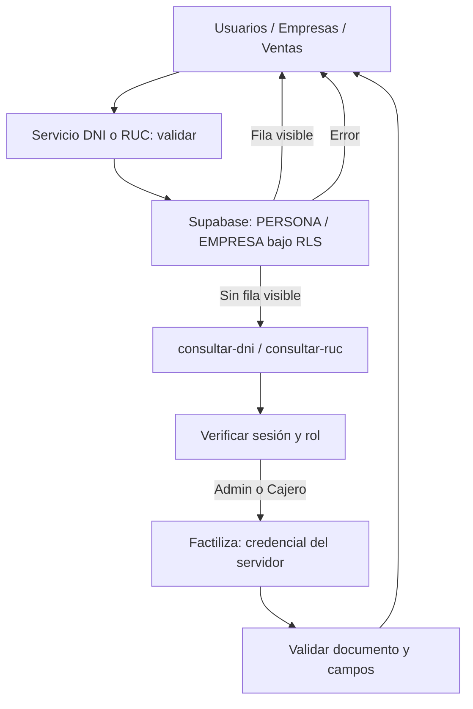

# Implementación: consulta local primero, proveedor desde Edge

Se mantienen HTML/CSS/JavaScript Vanilla, Supabase y Vercel. No se cambió el esquema ni se desactivó RLS.

## Cambios principales

| Antes | Después |
|---|---|
| Cada Edge recorría las claves y acababa en 404 incluso si fallaba el proveedor. | Un handler común en `supabase/functions/_shared/document-lookup.ts` selecciona una credencial, autoriza al operador y clasifica el error. |
| El backend enviaba todos los datos del proveedor sin comprobar el documento exacto. | Solo devuelve campos permitidos de DNI o RUC y exige coincidencia exacta del número. |
| URLs directas sin uso y respaldos/artefactos no excluidos. | Se retiraron las exportaciones obsoletas de `js/config.js` y el ejemplo de `EmpresaAdapter.js`; `.vercelignore` excluye artefactos; `.gitignore` previene agregar archivos de entorno. `sw.js` cambia la versión de caché para no conservar el shell anterior. |

## Navegador y formularios

- `js/services/documentLookup.js` aplica un plazo compartido de 15 s a PostgREST y `functions.invoke`, transmite la señal de cancelación y no reintenta. Un error de PostgREST detiene el flujo; solo una respuesta sin fila visible permite consultar Edge.
- `dniService.js`, `rucService.js` y `userService.js` validan y mantienen el contrato normalizado. El SDK puede devolver una respuesta HTTP dentro de `FunctionsHttpError.context`; se recupera el código reconocido, no el texto del proveedor.
- `documentLookupUI.js` y los controladores de Usuarios, Empresas y Ventas protegen contra resultados obsoletos y clics concurrentes. La limpieza recupera controles y solo se completan campos relevantes que siguen vacíos y sin edición manual.
- En Ventas, un RUC externo sin cliente requiere registrar la empresa y vincular el cliente jurídico en las pantallas existentes. No se crea una persona natural a partir del RUC ni se añade una transacción de dos escrituras al formulario de Ventas. Un DNI válido mantiene el alta rápida existente.

## Contrato y límites en Edge

- Éxito: `{ ok: true, data }`. Error: `{ ok: false, error, code }`; el texto en español no copia mensajes privados de Factiliza ni de Supabase.
- Permiso: validar bearer ante Supabase Auth; evaluar `is_admin` o `is_rol('CAJERO')` con el JWT del usuario. Si Auth o las RPC fallan, no se llama a Factiliza. CORS permite un origen exacto configurado o, por defecto, el dominio del proyecto.
- 400: formato; 401/403: usuario; 404: ausencia documentada para el número esperado; 429: cuota; 500: configuración o fallo interno; 502: credencial del proveedor, transporte o formato inválido; 503: indisponibilidad temporal; 504: plazo agotado.
- 12 s para el servidor y un máximo de 5 s por intento externo, incluida la lectura del cuerpo. Un solo reintento de 503 explícito, con jitter y `Retry-After` si cabe en el margen; el 429 nunca activa otro intento.
- Contrato consultado: [DNI](https://factiliza.gitbook.io/api-docs/apis/api-consulta/dni), [RUC](https://factiliza.gitbook.io/api-docs/apis/api-consulta/ruc), [errores](https://factiliza.gitbook.io/api-docs/especificaciones/codigo-de-errores). No se hizo una consulta real.
